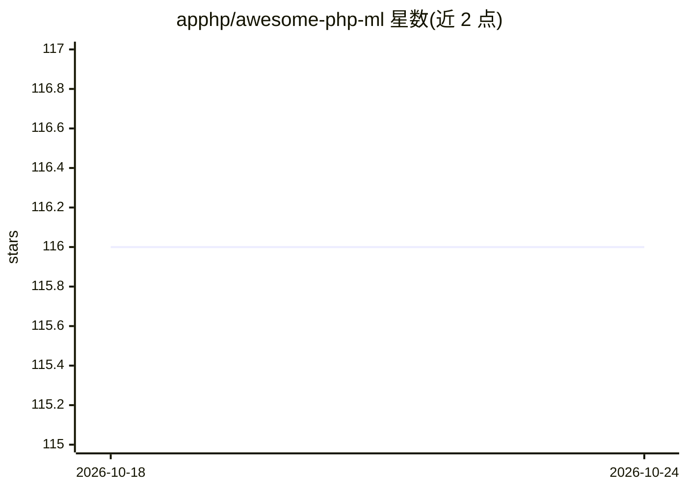

# apphp/awesome-php-ml

⭐ 117 · PHP · MIT · 推送 2026-09-19 · [GitHub](https://github.com/apphp/awesome-php-ml) · [官网](https://apphp.github.io/awesome-php-ml/) · 个人维护

**PHP 生态机器学习/AI/NLP/LLM 库的策展清单**

面向 PHP 开发者的 awesome 类策展清单，收录 PHP 的机器学习、深度学习、NLP、计算机视觉、数值计算、模型运行时与 LLM 客户端库，按类别组织并附使用指南、推荐技术栈与示例配方（如 Laravel RAG 应用的选型组合）。条目用 🌟/🧪/⚠️ 标注成熟度状态，并列出 PHP 版本要求、常见扩展依赖与内存建议。定位是选型导航，不提供代码本身，清单自身无需安装。

## 筛选速览

| 维度 | 判定 | 备注 |
|---|---|---|
| AI 角色 | `ai-knowledge` | 知识聚合/清单类 |
| 许可风险 | `permissive` | MIT |
| 部署形态 | `None` |  |
| 模型依赖 | — | README 未给出锁定关系 |
| 硬件要求 | — | 无带数字的原话,不猜 |
| 安装摩擦 | `low` | 无编译、无系统依赖或容器化 |
| 成熟度 | — | 结构信号不足 |

## 能力要点

- 按 ML/DL/NLP/CV/数值计算/LLM 客户端等类别组织 PHP 库条目
- 提供新手快速开始、推荐核心栈与示例配方（RAG、Laravel 集成）
- 🌟/🧪/⚠️ 标注条目成熟度与维护状态
- 列明 PHP 版本要求与常见扩展依赖（mbstring/curl/json/gd）

## 适用场景

- 为 PHP 项目挑选机器学习或 LLM 相关库
- 了解 PHP 生态 AI 库的覆盖范围与成熟度
- 按配方组合搭建 Laravel RAG 或 LLM 应用

## 场景标签

`精选清单` · 领域:学习与行业

## 证据(README 行号)

> L10: The most comprehensive curated list of **Machine Learning, Artificial Intelligence, NLP, LLM and Data Science libra
> L38: - Curated list of **PHP libraries and tools** for Machine Learning, AI, NLP, LLMs and Data Science.
> L40: - Aimed at **PHP developers** who want to add intelligent features to existing apps or build new AI-powered systems

## 星数曲线

2026-10-18 116 → 2026-10-24 116（+0）

---
*卡片 v1 · prompt 1.4 · 生成 2026-10-23 · 置信度 high · 依据 README sha `fe435862c2bf` · [字段定义](../../DATASET.md)*
