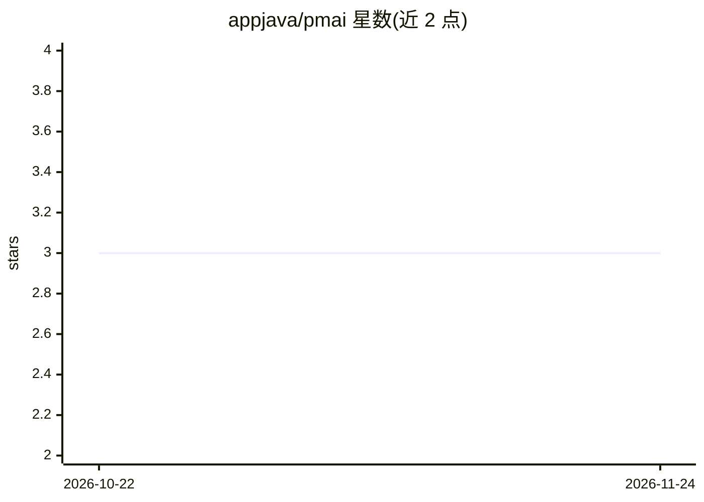

# appjava/pmai

⭐ 3 · 推送 2026-11-06 · [GitHub](https://github.com/appjava/pmai) · [官网](https://pmai-saas.web.app/) · 个人维护

**面向拉美小农户与农业中小企业的物联网农业环境监测 SaaS**

PMAI 是一个开源 SaaS 平台，为拉美小型生态农业生产者和农业中小企业提供环境变量（土壤湿度、温度、光照）实时监测、阈值告警邮件通知、离线优先缓存与背景同步、以及可导出 CSV/PDF 的可持续性报告。前端 React/TypeScript，后端 FastAPI，数据库开发用 SQLite、生产用 PostgreSQL+Supabase，配合 ESP32/DHT11 等低成本传感器。Qwen LLM 的预测分析、西英双语助手、自动报告与异常检测均列为路线图，尚未实现。

## 筛选速览

| 维度 | 判定 | 备注 |
|---|---|---|
| AI 角色 | `ai-enhanced` | 去掉 AI 部分产品仍成立 |
| 许可风险 | `none` | — |
| 部署形态 | `library` | 以包/库形式分发 |
| 模型依赖 | — | README 未给出锁定关系 |
| 硬件要求 | — | 无带数字的原话,不猜 |
| 安装摩擦 | `medium` | 含编译或系统依赖之一 |
| 成熟度 | — | 结构信号不足 |

## 能力要点

- 移动优先仪表盘实时展示 IoT 传感器数据
- 按阈值触发的邮件智能告警引擎
- 离线优先架构：本地缓存并在恢复联网后同步
- 路线图规划接入 Qwen 开源 LLM（预测/助手/报告/异常检测）

## 适用场景

- 在联网受限的农村地区监测农田土壤湿度与温度
- 为有机认证跟踪导出可持续性报告
- 按种植区分组管理 IoT 传感器节点并接收告警

## 场景标签

 · 领域:智慧农业/IoT

## 证据(README 行号)

> L7: **PMAI** is an open-source SaaS solution designed to empower small-scale agroecological producers and agricultural S
> L18: ## 🤖 Qwen AI Integration (Roadmap)
> L20: 1. **Predictive Crop Analysis:** Fine-tuning Qwen to analyze historical sensor patterns and predict irrigation need

## 星数曲线

2026-10-22 3 → 2026-11-24 3（+0）

---
*卡片 v1 · prompt 1.4 · 生成 2026-11-22 · 置信度 mid · 依据 README sha `8b6577063adb` · [字段定义](../../DATASET.md)*
