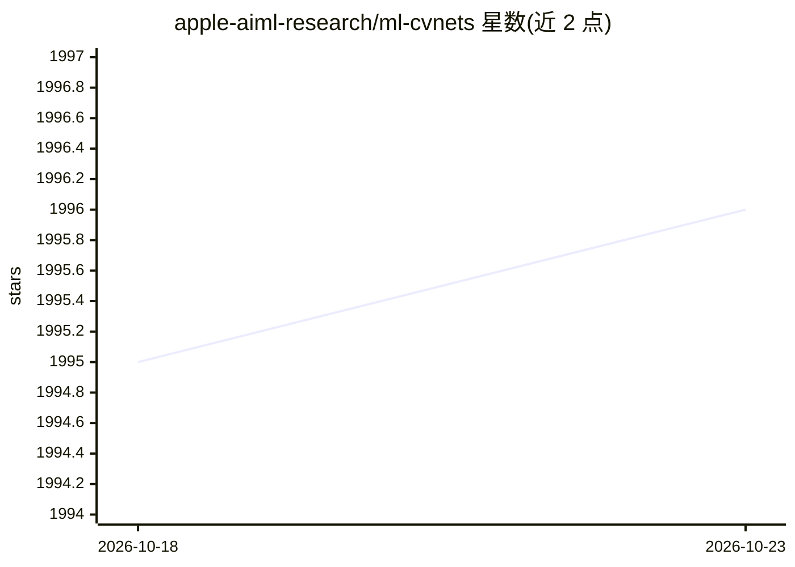

# apple-aiml-research/ml-cvnets

⭐ 1,996 · Python · NOASSERTION · 推送 2026-09-11 · [GitHub](https://github.com/apple-aiml-research/ml-cvnets) · [官网](https://apple-aiml-research.github.io/ml-cvnets/) · 组织维护

**训练计算机视觉网络的 PyTorch 工具库**

Apple 维护的计算机视觉训练工具库：面向研究人员和工程师，支持图像分类、目标检测、语义分割、多模态分类（ByteFormer）及基础模型（CLIP）的训练与评测，内置 MobileNet、EfficientNet、ViT、MobileViT、Swin、SSD、Mask R-CNN、DeepLabv3 等模型实现，并提供自动数据增强（RangeAugment 等）、知识蒸馏与 PyTorch 转 CoreML 支持。通过 git clone 源码 + Conda 环境安装，要求 Python 3.10+ 与 PyTorch >= 1.12.0。

## 筛选速览

| 维度 | 判定 | 备注 |
|---|---|---|
| AI 角色 | `ai-ecosystem` | LLM/agent 周边工具 |
| 许可风险 | `none` | NOASSERTION |
| 部署形态 | `None` |  |
| 模型依赖 | — | README 未给出锁定关系 |
| 硬件要求 | — | 无带数字的原话,不猜 |
| 安装摩擦 | `low` | 无编译、无系统依赖或容器化 |
| 成熟度 | — | 结构信号不足 |

## 能力要点

- 覆盖分类/检测/分割/基础模型（CLIP）多任务的训练与评测
- 内置 CNN 与 Transformer 两类骨干的多种模型实现
- 支持自动数据增强（RangeAugment/AutoAugment/RandAugment）与软/硬知识蒸馏
- 提供 PyTorch 模型转 CoreML 的示例

## 适用场景

- 研究人员训练和评测视觉模型并复现论文设置
- 工程师在移动端与非移动端任务上训练视觉模型
- 将训练好的 PyTorch 模型转换为 CoreML 部署

## 场景标签

`模型训练` · 领域:训练与推理

## 证据(README 行号)

> L3: CVNets is a computer vision toolkit that allows researchers and engineers to train standard and novel mobile-
> L4: and non-mobile computer vision models for variety of tasks, including object classification, object detection,

## 星数曲线

2026-10-18 1,995 → 2026-10-23 1,996（+1）

---
*卡片 v1 · prompt 1.4 · 生成 2026-10-21 · 置信度 high · 依据 README sha `7b4574387bef` · [字段定义](../../DATASET.md)*
