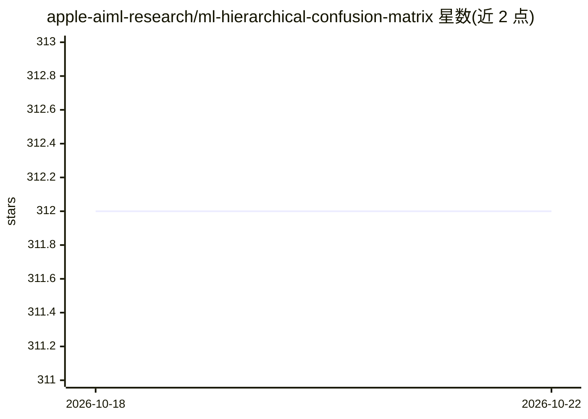

# apple-aiml-research/ml-hierarchical-confusion-matrix

⭐ 312 · TypeScript · NOASSERTION · 推送 2026-09-11 · [GitHub](https://github.com/apple-aiml-research/ml-hierarchical-confusion-matrix) · [官网](https://apple-aiml-research.github.io/ml-hierarchical-confusion-matrix/) · 组织维护

**层次与多输出混淆矩阵的可视化分析系统**

CHI 2022 论文 Neo 的配套代码：一个可视化分析系统，支持创建与交互层次化、多输出的混淆矩阵，展示派生指标、重归一化混淆并共享矩阵规格。以 npm 包 @apple/hierarchical-confusion-matrix 形式嵌入项目，或直接引入编译后的 confMat.js 文件；数据可从 json/csv/vega 及合成示例加载，通过 `:` 表示层级、`,` 表示多输出标签。面向评估机器学习模型的开发与研究者。

## 筛选速览

| 维度 | 判定 | 备注 |
|---|---|---|
| AI 角色 | `ai-ecosystem` | LLM/agent 周边工具 |
| 许可风险 | `none` | NOASSERTION |
| 部署形态 | `library` | 以包/库形式分发 |
| 模型依赖 | — | README 未给出锁定关系 |
| 硬件要求 | — | 无带数字的原话,不猜 |
| 安装摩擦 | `low` | 无编译、无系统依赖或容器化 |
| 成熟度 | — | 结构信号不足 |

## 能力要点

- 支持层次化与多输出标签的混淆矩阵
- 可视化派生指标与重归一化混淆
- 提供 json/csv/vega/synth 多种数据加载器
- npm 包嵌入或编译文件两种使用方式

## 适用场景

- 评估具有层次或多个输出标签的分类模型
- 将混淆矩阵可视化嵌入自己的分析项目
- 探索混淆矩阵的派生指标与重归一化视图

## 场景标签

`模型评测` · 领域:评测与运维

## 证据(README 行号)

> L5: The confusion matrix, a ubiquitous visualization for helping people evaluate machine learning models, is a tabular l
> L7: This code accompanies the research paper:

## 星数曲线

2026-10-18 312 → 2026-10-22 312（+0）

---
*卡片 v1 · prompt 1.4 · 生成 2026-10-21 · 置信度 high · 依据 README sha `9697bd06dfb0` · [字段定义](../../DATASET.md)*
