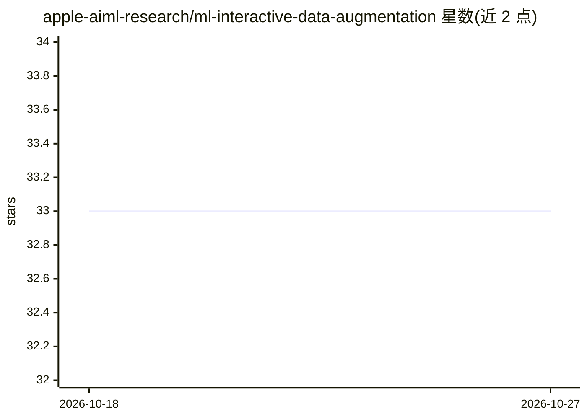

# apple-aiml-research/ml-interactive-data-augmentation

⭐ 33 · Svelte · NOASSERTION · 推送 2026-09-11 · [GitHub](https://github.com/apple-aiml-research/ml-interactive-data-augmentation) · 组织维护

**交互式文本数据增强研究工具：可视化嵌入并填充数据空白区**

CHI 2025 论文《Exploring Empty Spaces》的配套代码。Amplio 可视化输入句子的嵌入，帮助用户探索并填充数据分布中数据点稀少的'空白区'，提供三种人在回路增强方法：Augment with LLM、Augment by Interpolation、Augment with Concepts。系统由后端（Python/pipenv，端口 5000）与前端（npm/Svelte，端口 5173）两部分组成，运行需配置 API key 的 secrets.json；数据与模型文件随仓库提供，基于 Python 3.11 生成，版本不符时需用 notebook 重新生成。新增数据集需手动编辑后端与前端指定文件。

## 筛选速览

| 维度 | 判定 | 备注 |
|---|---|---|
| AI 角色 | `ai-ecosystem` | LLM/agent 周边工具 |
| 许可风险 | `none` | NOASSERTION |
| 部署形态 | `library` | 以包/库形式分发 |
| 模型依赖 | — | README 未给出锁定关系 |
| 硬件要求 | — | 无带数字的原话,不猜 |
| 安装摩擦 | `low` | 无编译、无系统依赖或容器化 |
| 成熟度 | — | 结构信号不足 |

## 能力要点

- 三种人在回路文本增强方法（LLM/插值/概念）
- 句子嵌入可视化以识别数据空白区
- 数据与模型文件随仓库提供，附再生成 notebook

## 适用场景

- 探索数据集嵌入空间中的稀疏区域并系统补充数据
- 用 LLM 或插值方法扩充非结构化文本数据集
- 复现或扩展 CHI 2025 论文的人机回异数据增强流程

## 场景标签

`科研工具` · 领域:学习与行业

## 证据(README 行号)

> L3: Amplio is an interactive research tool for data augmentation. The system visualizes the embeddings of input sentence
> L7: This code accompanies the research paper:

## 星数曲线

2026-10-18 33 → 2026-10-27 33（+0）

---
*卡片 v1 · prompt 1.4 · 生成 2026-10-25 · 置信度 mid · 依据 README sha `c44136b9e4f8` · [字段定义](../../DATASET.md)*
