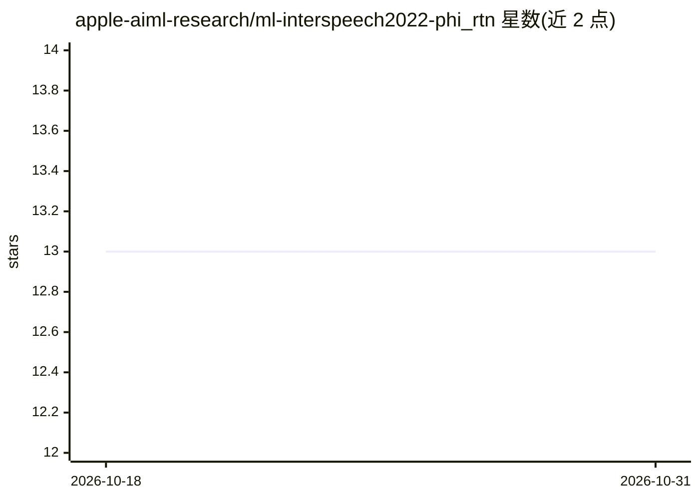

# apple-aiml-research/ml-interspeech2022-phi_rtn

⭐ 13 · NOASSERTION · 推送 2026-09-11 · [GitHub](https://github.com/apple-aiml-research/ml-interspeech2022-phi_rtn) · [官网](https://machinelearning.apple.com/research/space-efficient-representation) · 组织维护

**Interspeech 2022 论文配套的实体中心查询语言模型数据集**

随 Interspeech 2022 论文《Space-Efficient Representation of Entity-centric Query Language Models》发布的数据仓库：包含带权重的两级语法模板（含实体槽位）与媒体实体列表，模板代表用户对虚拟助手的音频内容目录（歌曲/艺人/播放列表/播客等）导航与交互查询，权重表示用例重要性；实体约 2021 年 12 月从大规模媒体目录抽取，权重来自某流媒体服务的流行度。数据以 GZIP 压缩的 CSV 提供，README 附 Python 解析示例。仅发布数据，不含模型代码。

## 筛选速览

| 维度 | 判定 | 备注 |
|---|---|---|
| AI 角色 | `ai-knowledge` | 知识聚合/清单类 |
| 许可风险 | `none` | NOASSERTION |
| 部署形态 | `None` |  |
| 模型依赖 | — | README 未给出锁定关系 |
| 硬件要求 | — | 无带数字的原话,不猜 |
| 安装摩擦 | `low` | 无编译、无系统依赖或容器化 |
| 成熟度 | — | 结构信号不足 |

## 能力要点

- 带权重的实体槽位查询模板（两级语法）
- 来自大规模媒体目录的带权重实体列表
- GZIP 压缩 CSV 格式，附 Python 解析示例
- 面向语音助手媒体查询场景，供引用（Interspeech 2022）

## 适用场景

- 在语音助手查询建模研究中复现或对比该论文数据
- 构建/评测实体中心的查询语言模型
- 研究音频内容目录上的用户查询分布

## 场景标签

`模型评测` · 领域:评测与运维

## 证据(README 行号)

> L3: This repository hosts the data released as part of the Interspeech 2022 publication titled "*Space-Efficient Represe
> L5: The templates represent use-case queries where a user instructs a virtual assistant to navigate, or interact with, a

## 星数曲线

2026-10-18 13 → 2026-10-31 13（+0）

---
*卡片 v1 · prompt 1.4 · 生成 2026-10-31 · 置信度 high · 依据 README sha `868812bae097` · [字段定义](../../DATASET.md)*
