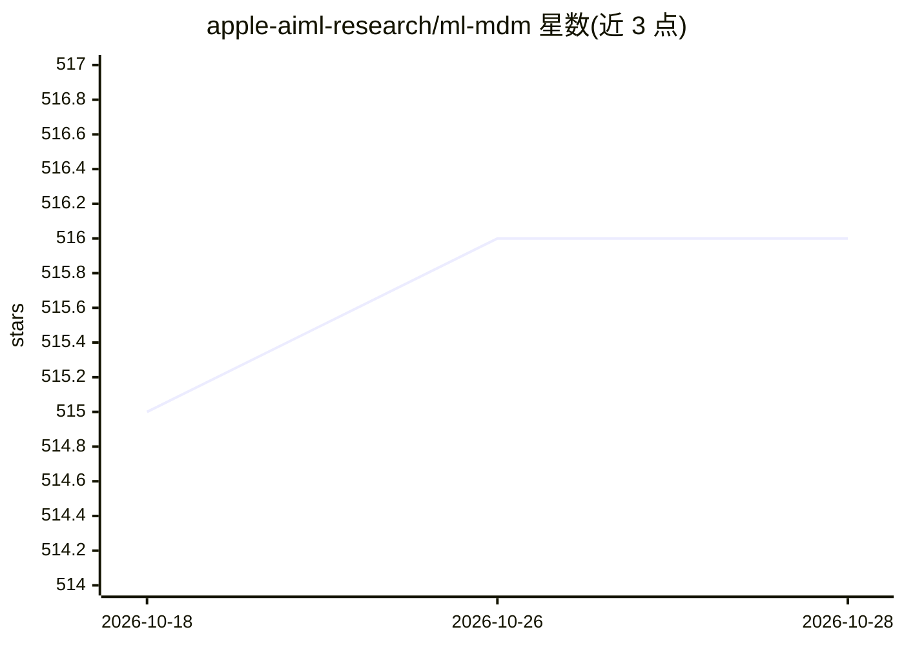

# apple-aiml-research/ml-mdm

⭐ 516 · Python · MIT · 推送 2026-09-11 · [GitHub](https://github.com/apple-aiml-research/ml-mdm) · [官网](https://machinelearning.apple.com/research/matryoshka-diffusion-models) · 组织维护

**训练高分辨率文生图扩散模型的研究框架（Matryoshka）**

Apple 研究团队随论文《Matryoshka Diffusion Models》发布的 Python 训练框架：提供嵌套 U-Net 等模型实现与 DDPM 管线，支持在像素空间训练最高 1024x1024 的文生图/视频扩散模型，含数据准备脚本（基于 img2dataset 下载 CC12M）、训练与采样 CLI、S3 数据集管理与 Web 演示。默认依赖可在纯 CPU 机器安装，实际训练支持 CUDA（用户验证过 cuda_12 / cuda-11.8）与 Python 3.9/3.10。提供基于 50M Flickr 文图对训练的预训练 checkpoint 下载。

## 筛选速览

| 维度 | 判定 | 备注 |
|---|---|---|
| AI 角色 | `ai-native` | 本体是模型或模型工具 |
| 许可风险 | `permissive` | MIT |
| 部署形态 | `library` | 以包/库形式分发 |
| 模型依赖 | — | README 未给出锁定关系 |
| 硬件要求 | `cpu-ok` | |
| 安装摩擦 | `medium` | 含编译或系统依赖之一 |
| 成熟度 | — | 结构信号不足 |

## 能力要点

- 像素空间单模型训练至 1024x1024 分辨率
- 开源 U-Net 与嵌套 U-Net 实现、DDPM 管线
- CC12M 数据下载/切分脚本与训练教程
- 提供 Flickr64/256/1024 预训练 checkpoint 与 Web 演示

## 适用场景

- 复现或扩展 Matryoshka 扩散模型论文方法
- 用 CC12M 等数据集从零训练文生图扩散模型
- 下载预训练 checkpoint 做采样或 Web 演示

## 场景标签

`图像生成` `模型训练` · 领域:内容生成

## 证据(README 行号)

> L3: `ml_mdm` is a python package for efficiently training high quality text-to-image diffusion models — brought to the p
> L21: Remarkably, we can train a single pixel-space model at resolutions of up to 1024x1024 pixels, demonstrating strong 

## 星数曲线

2026-10-18 515 → 2026-10-28 516（+1）

---
*卡片 v1 · prompt 1.4 · 生成 2026-10-21 · 置信度 high · 依据 README sha `be88e9c53528` · [字段定义](../../DATASET.md)*
