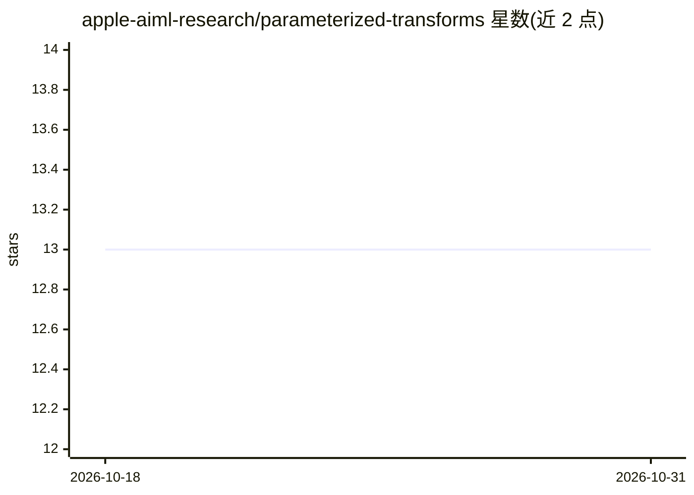

# apple-aiml-research/parameterized-transforms

⭐ 13 · Python · Apache-2.0 · 推送 2026-09-11 · [GitHub](https://github.com/apple-aiml-research/parameterized-transforms) · [官网](https://apple-aiml-research.github.io/parameterized-transforms/) · 组织维护

**torchvision 数据增强变换的参数化封装库，可读取/复现增强参数**

基于 torchvision 的变换封装包：以统一、模块化、可扩展的方式实现图像增强变换，并向用户开放其参数化接口。支持两项能力：给定图像，返回增强结果及其所用参数；给定图像与参数，返回对应的增强结果。通过 git clone + pip install -e . 或直接 pip install（GitHub URL）安装，附带教程系列与单元测试。由 Apple 的多位研究与工程人员参与开发。

## 筛选速览

| 维度 | 判定 | 备注 |
|---|---|---|
| AI 角色 | `ai-native` | 本体是模型或模型工具 |
| 许可风险 | `permissive` | Apache-2.0 |
| 部署形态 | `library` | 以包/库形式分发 |
| 模型依赖 | — | README 未给出锁定关系 |
| 硬件要求 | — | 无带数字的原话,不猜 |
| 安装摩擦 | `low` | 无编译、无系统依赖或容器化 |
| 成熟度 | — | 结构信号不足 |

## 能力要点

- 对图像增强返回结果及所用参数
- 给定参数可复现对应增强
- 统一、模块化、可扩展的 torchvision 变换封装

## 适用场景

- 记录增强参数以复现特定数据增强
- 在训练流程中显式控制增强的参数化
- 扩展自定义的参数化 torchvision 变换

## 场景标签

`图像视频处理` · 领域:感知与多模态

## 证据(README 行号)

> L9: * The package provides a uniform, modular, and easily extendable implementation of `torchvision`-based transforms th
> L11:  * Given an image, the transform can return an augmentation along with the parameters used for the augmentation.
> L12:  * Given an image and augmentation parameters, the transform can return the corresponding augmentation.

## 星数曲线

2026-10-18 13 → 2026-10-31 13（+0）

---
*卡片 v1 · prompt 1.4 · 生成 2026-10-31 · 置信度 mid · 依据 README sha `40a31767c77e` · [字段定义](../../DATASET.md)*
