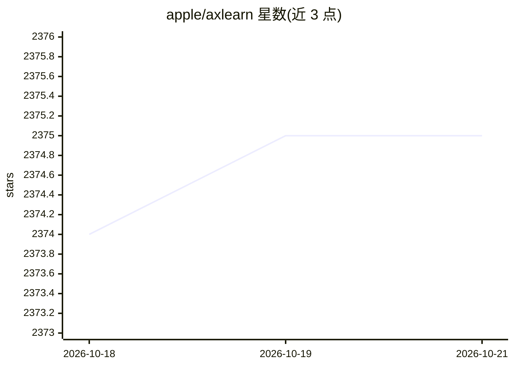

# apple/axlearn

⭐ 2,375 · Python · Apache-2.0 · 推送 2026-07-08 · [GitHub](https://github.com/apple/axlearn) · 组织维护

**面向大规模模型的 JAX/XLA 深度学习训练库，给模型开发者**

Apple 维护的深度学习库，构建于 JAX 与 XLA 之上，用于开发、迭代和维护大规模模型。采用面向对象设计，配置系统支持从可复用模块组合模型，并可与 Flax、Hugging Face transformers 集成。基于 GSPMD 的全局计算范式描述计算，支持在数千个加速器上训练数千亿参数模型，并提供在公有云上部署管理作业与数据的工具，覆盖 NLP、计算机视觉与语音识别等应用。README 声明 API 处于活跃开发中、可能变更；安装说明指向 RELEASE.md。

## 筛选速览

| 维度 | 判定 | 备注 |
|---|---|---|
| AI 角色 | `ai-ecosystem` | LLM/agent 周边工具 |
| 许可风险 | `permissive` | Apache-2.0 |
| 部署形态 | `library` | 以包/库形式分发 |
| 模型依赖 | — | README 未给出锁定关系 |
| 硬件要求 | — | 无带数字的原话,不猜 |
| 安装摩擦 | `low` | 无编译、无系统依赖或容器化 |
| 成熟度 | `idea` | |

## 能力要点

- 基于 JAX/XLA，支持数千加速器上训练数千亿参数模型
- 配置系统支持可复用模块组合，可集成 Flax 与 Hugging Face transformers
- 基于 GSPMD 的全局计算范式
- 提供公有云作业与数据部署管理工具

## 适用场景

- 开发与迭代大规模深度学习模型
- 在公有云上部署和管理训练作业与数据
- 训练 NLP、计算机视觉、语音识别基线模型

## 场景标签

 · 领域:深度学习基础设施

## 证据(README 行号)

> L11: AXLearn is a library built on top of JAX and XLA to support the development of large-scale deep learning models.
> L13: AXLearn takes an object-oriented approach to the software engineering challenges that arise from building, iteratin

## 星数曲线

2026-10-18 2,374 → 2026-10-21 2,375（+1）

---
*卡片 v1 · prompt 1.4 · 生成 2026-10-21 · 置信度 high · 依据 README sha `d590a1e99624` · [字段定义](../../DATASET.md)*
