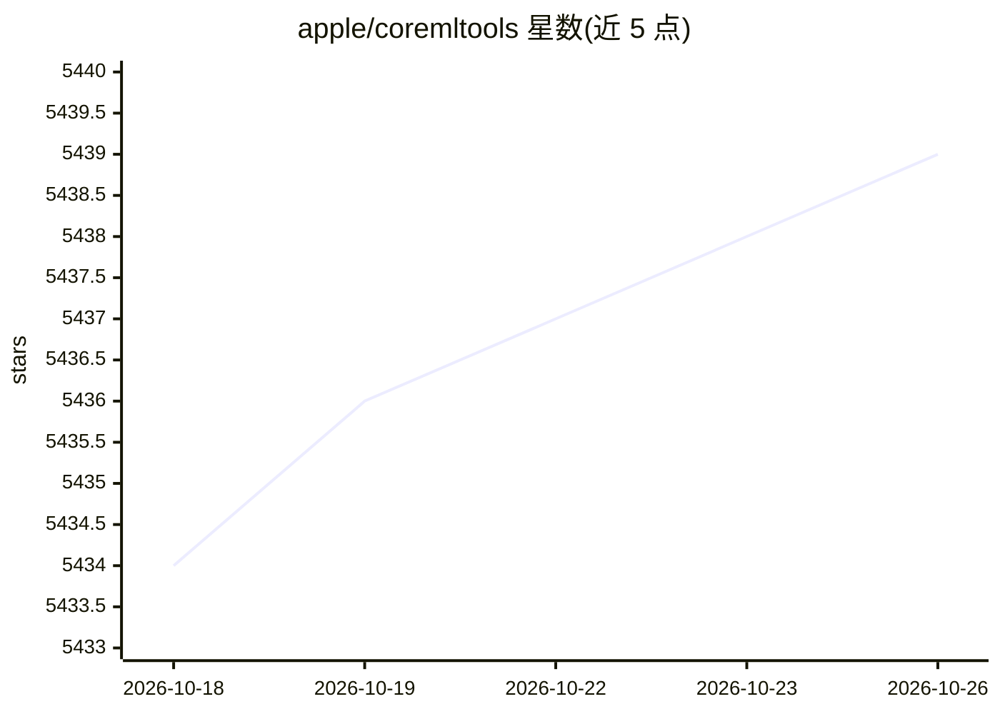

# apple/coremltools

⭐ 5,439 · Python · BSD-3-Clause · 推送 2026-09-30 · [GitHub](https://github.com/apple/coremltools) · [官网](https://coremltools.readme.io) · 组织维护

**Apple 官方模型转换工具：把训练框架模型转为 Core ML 格式**

Apple 维护的 Python 包 coremltools，用于将第三方训练库的机器学习模型转换为 Core ML 格式，支持 TensorFlow 1.x/2.x、PyTorch，以及 scikit-learn、XGBoost、LibSVM 等非神经网络框架。转换后可读写、优化 Core ML 模型，并在 macOS 上通过 Core ML 做预测以核验转换结果。面向需要在 Xcode 应用中集成设备端模型的 Apple 平台开发者；限制：部分核验功能依赖 macOS。

## 筛选速览

| 维度 | 判定 | 备注 |
|---|---|---|
| AI 角色 | `ai-ecosystem` | LLM/agent 周边工具 |
| 许可风险 | `permissive` | BSD-3-Clause |
| 部署形态 | `library` | 以包/库形式分发 |
| 模型依赖 | — | README 未给出锁定关系 |
| 硬件要求 | — | 无带数字的原话,不猜 |
| 安装摩擦 | `low` | 无编译、无系统依赖或容器化 |
| 成熟度 | — | 结构信号不足 |

## 能力要点

- 从 TensorFlow/PyTorch/scikit-learn/XGBoost/LibSVM 转换模型到 Core ML 格式
- 读取、写入与优化 Core ML 模型
- 在 macOS 上通过 Core ML 预测核验转换结果
- 转换后可在 Xcode 中集成到应用

## 适用场景

- 把 PyTorch/TensorFlow 训练的模型部署到 Apple 设备
- 优化与编辑已有的 Core ML 模型
- 在 macOS 上验证转换后模型的预测输出

## 场景标签

`推理引擎` · 领域:训练与推理

## 证据(README 行号)

> L9: Use Core ML Tools (*coremltools*) to convert machine learning models from third-party libraries to the Core ML forma
> L21: * Convert trained models to the Core ML format.

## 星数曲线

2026-10-18 5,434 → 2026-10-26 5,439（+5）

---
*卡片 v1 · prompt 1.4 · 生成 2026-10-20 · 置信度 high · 依据 README sha `a27e0aab106d` · [字段定义](../../DATASET.md)*
