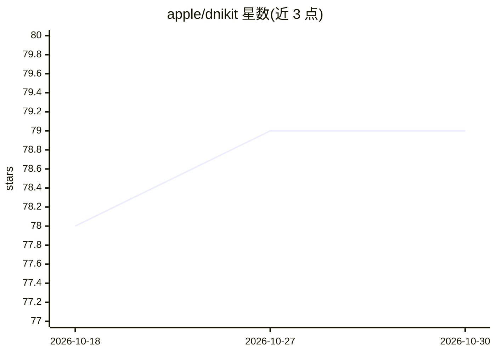

# apple/dnikit

⭐ 79 · Python · Apache-2.0 · 推送 2026-09-25 · [GitHub](https://github.com/apple/dnikit) · [官网](https://apple.github.io/dnikit/) · 组织维护

**分析机器学习模型与数据集的 Python 内省工具包**

DNIKit（Data and Network Introspection Kit）是 Apple 维护的 Python 工具包，用于对机器学习模型和数据集进行内省分析。README 仅给出安装说明：通过 pip 从 PyPI 安装，可选用 notebook 附加项以运行附带的 notebook 示例，随后用 jupyter notebook 启动。仓库主题标签涉及偏差、公平性、数据重复、模型压缩等分析方向，但具体功能机制需查阅其完整文档，README 本身未展开描述。

## 筛选速览

| 维度 | 判定 | 备注 |
|---|---|---|
| AI 角色 | `ai-ecosystem` | LLM/agent 周边工具 |
| 许可风险 | `permissive` | Apache-2.0 |
| 部署形态 | `library` | 以包/库形式分发 |
| 模型依赖 | — | README 未给出锁定关系 |
| 硬件要求 | — | 无带数字的原话,不猜 |
| 安装摩擦 | `low` | 无编译、无系统依赖或容器化 |
| 成熟度 | — | 结构信号不足 |

## 能力要点

- 面向机器学习模型与数据集的内省分析
- 通过 pip 从 PyPI 安装
- 提供 notebook 附加安装项以运行示例

## 适用场景

- 分析模型内部行为与数据集特性
- 开展与偏差、公平性、数据重复相关的检查工作

## 场景标签

`模型评测` · 领域:评测与运维

## 证据(README 行号)

> L3: A Python toolkit for introspection of machine learning models and datasets.

## 星数曲线

2026-10-18 78 → 2026-10-30 79（+1）

---
*卡片 v1 · prompt 1.4 · 生成 2026-10-24 · 置信度 mid · 依据 README sha `3b827a7a1337` · [字段定义](../../DATASET.md)*
