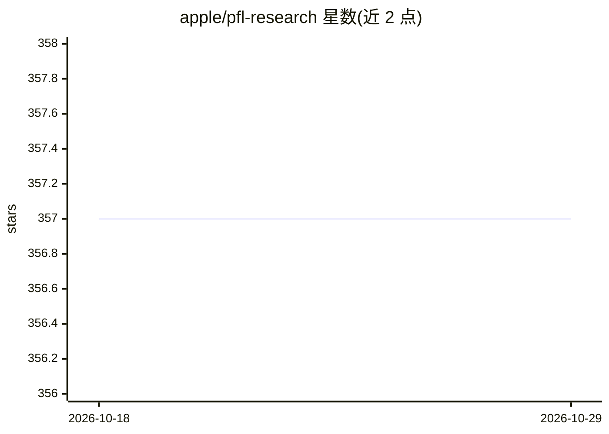

# apple/pfl-research

⭐ 357 · Jupyter Notebook · Apache-2.0 · 推送 2026-10-21 · [GitHub](https://github.com/apple/pfl-research) · [官网](http://apple.github.io/pfl-research/) · 组织维护

**Apple 出品的隐私保护联邦学习仿真研究框架**

Python 框架 pfl，供研究人员在隐私保护联邦学习（PFL）场景下运行高效仿真并发布研究成果。支持 PyTorch、TensorFlow 与 MLX（限 Apple silicon 本地运行），支持神经网络以外模型如 GBDT，内置本地与中心化差分隐私机制，提供多进程/多 GPU/多机分布式训练加速仿真，附统一基准数据集与 benchmark 目录、Colab 教程笔记本。声明不用于第三方 FL 生产部署，仿真结果可供实际部署参考。以论文形式发表（arXiv:2404.06430）。

## 筛选速览

| 维度 | 判定 | 备注 |
|---|---|---|
| AI 角色 | `ai-ecosystem` | LLM/agent 周边工具 |
| 许可风险 | `permissive` | Apache-2.0 |
| 部署形态 | `library` | 以包/库形式分发 |
| 模型依赖 | — | README 未给出锁定关系 |
| 硬件要求 | — | 无带数字的原话,不猜 |
| 安装摩擦 | `low` | 无编译、无系统依赖或容器化 |
| 成熟度 | — | 结构信号不足 |

## 能力要点

- 支持 PyTorch、TensorFlow 与 MLX 多框架
- 本地与中心化差分隐私机制紧密集成
- 多进程/多 GPU/多机的分布式仿真加速
- 统一基准数据集与 benchmark 目录

## 适用场景

- 研究人员快速验证隐私保护联邦学习新想法
- 复现或扩展现有 FL 基准实验
- 通过 Colab 笔记本学习联邦学习与差分隐私组件

## 场景标签

`模型训练` `教程课程` · 领域:学习与行业

## 证据(README 行号)

> L9: `pfl` is a Python framework developed at Apple to empower researchers to run efficient simulations with privacy-pres
> L20: * Support both PyTorch and TensorFlow.

## 星数曲线

2026-10-18 357 → 2026-10-29 357（+0）

---
*卡片 v1 · prompt 1.4 · 生成 2026-10-21 · 置信度 high · 依据 README sha `16fd2882c3b0` · [字段定义](../../DATASET.md)*
