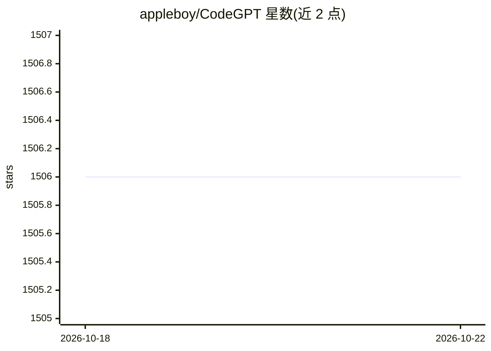

# appleboy/CodeGPT

⭐ 1,505 · Go · MIT · 推送 2026-09-29 · [GitHub](https://github.com/appleboy/CodeGPT) · 个人维护 · 中文 README

**为开发者用 AI 生成 git 提交信息与代码审查摘要的 CLI**

用 Go 编写的命令行工具：读取 git diff，调用 LLM 生成符合 conventional commits 规范的提交信息，或生成代码审查摘要，并可自动安装 git prepare-commit-msg 钩子。支持 OpenAI、Azure OpenAI、Gemini（含 VertexAI）、Anthropic、Ollama、Groq、OpenRouter 与 LiteLLM proxy 等后端，可通过 api_key_helper 从密码管理器动态取钥，API key 存于系统 keyring 并有文件回退。提供 brew、Chocolatey、安装脚本、预编译二进制与 go install 等安装途径。

## 筛选速览

| 维度 | 判定 | 备注 |
|---|---|---|
| AI 角色 | `ai-native` | 本体是模型或模型工具 |
| 许可风险 | `permissive` | MIT |
| 部署形态 | `desktop` | 安装包/桌面程序 |
| 模型依赖 | local-ok | 支持本地模型 |
| 硬件要求 | — | 无带数字的原话,不猜 |
| 安装摩擦 | `low` | 无编译、无系统依赖或容器化 |
| 成熟度 | — | 结构信号不足 |

## 能力要点

- 生成符合 conventional commits 规范的提交信息
- 自动安装 git prepare-commit-msg 钩子
- 支持 OpenAI/Azure/Gemini/Anthropic/Ollama/Groq/OpenRouter/LiteLLM 等后端
- api_key_helper 动态取钥（密码管理器/云密钥服务）+ OS keyring 凭据存储
- 可自定义 prompt 模板、diff 上下文行数与文件排除模式

## 适用场景

- 提交代码时自动生成规范化 commit message
- 让 AI 基于改动产出简短的代码审查摘要
- 通过 prepare-commit-msg 钩子在工作流中无感生成提交信息

## 场景标签

`代码审查` · 领域:编码与开发

## 证据(README 行号)

> L7: A CLI tool written in Go that generates git commit messages or provides code review summaries using ChatGPT AI (gpt-
> L20: - Supports Azure OpenAI Service, OpenAI API, [Gemini][60], [Anthropic][100], [Ollama][41], [Groq][30], [OpenRouter]

## 星数曲线

2026-10-18 1,506 → 2026-10-22 1,506（+0）

---
*卡片 v1 · prompt 1.4 · 生成 2026-10-21 · 置信度 high · 依据 README sha `5ead7e3203ae` · [字段定义](../../DATASET.md)*
