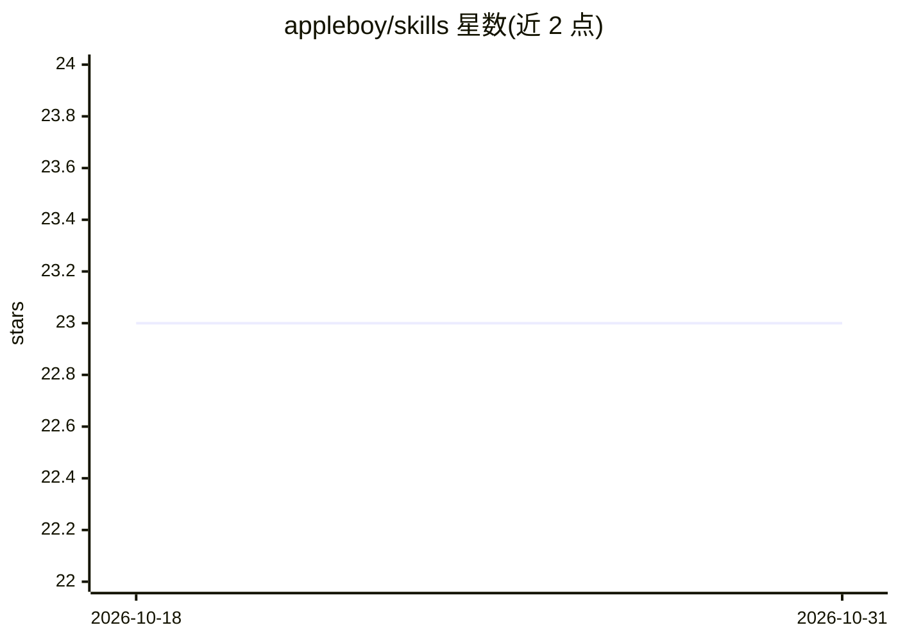

# appleboy/skills

⭐ 23 · 推送 2026-09-12 · [GitHub](https://github.com/appleboy/skills) · 个人维护

**面向 Claude Code/Codex 的 agent 技能插件集合**

由 appleboy 维护的 Agent Skills 集合，以插件市场（marketplace）形式分发，通过 /plugin 命令或 CLI 安装到 Claude Code 与 Codex 中。收录 7 个技能，覆盖提交信息生成、Copilot/Codex 单轮审查修复循环、提示词审计与重写、PR 描述准备与 AI 署名披露、功能规划文档生成、变更分级判定等开发工作流环节。各插件由宿主工具分别管理，更新需刷新市场并逐个升级插件。

## 筛选速览

| 维度 | 判定 | 备注 |
|---|---|---|
| AI 角色 | `ai-knowledge` | 知识聚合/清单类 |
| 许可风险 | `none` | — |
| 部署形态 | `None` |  |
| 模型依赖 | — | README 未给出锁定关系 |
| 硬件要求 | — | 无带数字的原话,不猜 |
| 安装摩擦 | `low` | 无编译、无系统依赖或容器化 |
| 成熟度 | — | 结构信号不足 |

## 能力要点

- 以 marketplace 形式分发，Claude Code 与 Codex 各自独立安装
- 7 个技能覆盖提交信息、代码审查、提示词审计、PR 准备等开发流程
- copilot-review/codex-review 支持配合 /loop 循环重复执行

## 适用场景

- 在 Claude Code 或 Codex 会话中安装提交信息生成与代码审查技能
- 用 prompt-audit 按六要素审计并重写提示词
- 用 pr-prepare 生成带 AI 署名披露的 PR 描述

## 场景标签

`提示工程` `代码审查` · 领域:Agent 开发

## 证据(README 行号)

> L6: Agent Skills Collection.
> L69: |Skill|Description|

## 星数曲线

2026-10-18 23 → 2026-10-31 23（+0）

---
*卡片 v1 · prompt 1.4 · 生成 2026-10-27 · 置信度 high · 依据 README sha `74a38cc5ada1` · [字段定义](../../DATASET.md)*
