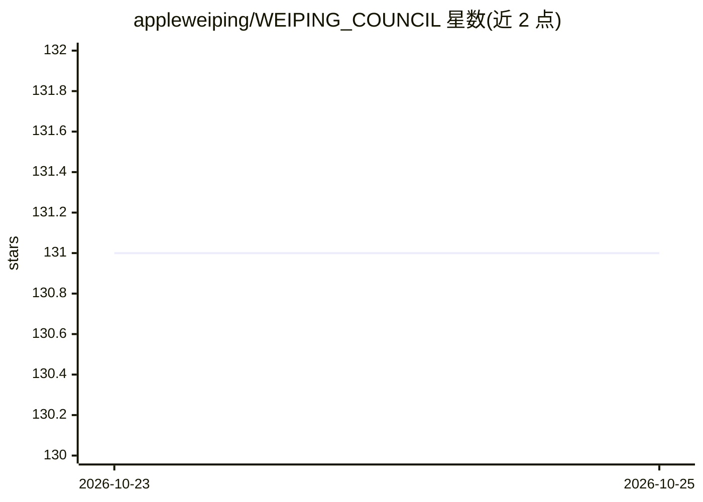

# appleweiping/WEIPING_COUNCIL

⭐ 131 · Python · MIT · 推送 2026-10-22 · [GitHub](https://github.com/appleweiping/WEIPING_COUNCIL) · 个人维护

**多 LLM 议会问答应用：匿名互评后由主席合成答案**

基于 FastAPI + React 的本地 Web 应用与 CLI：将一个问题发给多个 LLM 成员，按 7 种协议（council/debate/redteam/consensus/specialist/tournament/auto）执行匿名互评、辩论或锦标赛，最终由主席角色合成答案并给出异议与置信度；每次运行记录全部阶段、逐调用追踪（角色、模型、延迟、错误）与降级警告，保存为会话 JSON。默认经 OpenRouter 访问模型，任一 OpenAI 兼容端点可用。附 demo 模式与基于 GSM8K 的评测脚本。

## 筛选速览

| 维度 | 判定 | 备注 |
|---|---|---|
| AI 角色 | `ai-native` | 本体是模型或模型工具 |
| 许可风险 | `permissive` | MIT |
| 部署形态 | `library` | 以包/库形式分发 |
| 模型依赖 | locked-api |  |
| 硬件要求 | — | 无带数字的原话,不猜 |
| 安装摩擦 | `low` | 无编译、无系统依赖或容器化 |
| 成熟度 | `idea` | |

## 能力要点

- 7 种多模型协议（匿名互评/辩论/红队/共识/锦标赛等），auto 按问题启发式路由
- 逐调用追踪：角色、模型 id、尝试次数、延迟、错误类别
- 置信度低于 0.85 触发最多三轮自我精炼
- 本地 CLI 与 REST API（/api/query、/api/health 等），会话保存为 JSON

## 适用场景

- 对重要决策问题获取多个模型的交叉评审与合成答案
- 比较不同协议（议会/辩论/红队）在同一问题上的输出差异
- 审计每次回答的模型调用链路、异议与降级状态

## 场景标签

`多智能体` · 领域:Agent 开发

## 证据(README 行号)

> L3: A local web app and CLI that sends one question to several LLMs, has them review each
> L52: |`council`|all answer, each ranks the others anonymously, the chairman synthesizes|13|
> L82: use `openai/gpt-5.5` through OpenRouter and the bulk worker uses

## 星数曲线

2026-10-23 131 → 2026-10-25 131（+0）

---
*卡片 v1 · prompt 1.4 · 生成 2026-10-23 · 置信度 mid · 依据 README sha `e25cec72e31c` · [字段定义](../../DATASET.md)*
