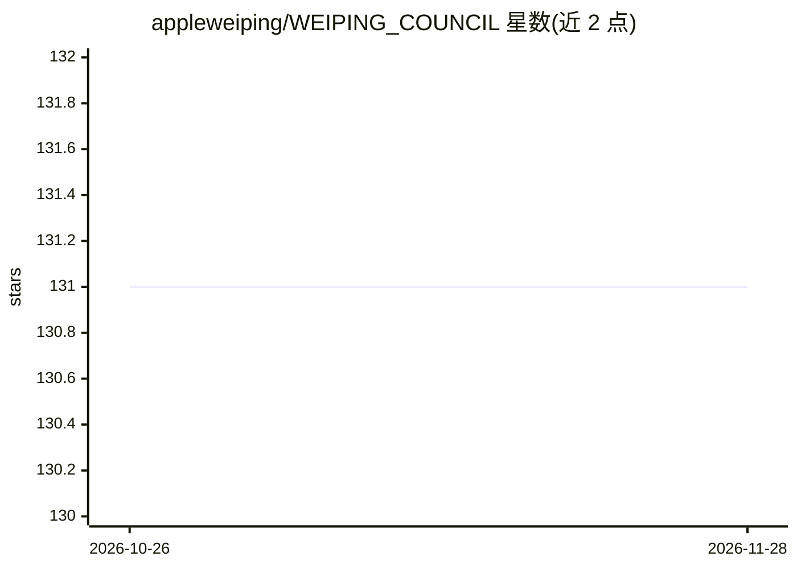

# appleweiping/WEIPING_COUNCIL

⭐ 131 · Python · MIT · 推送 2026-10-25 · [GitHub](https://github.com/appleweiping/WEIPING_COUNCIL) · 个人维护

**本地多 LLM 议会工具：让多个模型互评并给出主席综合意见**

本地运行的 Web 应用与 CLI：将一个问题发给多个 LLM 成员，通过匿名互评、主席综合等 7 种协议（council/debate/redteam/consensus/specialist/tournament/auto）产出带异议与置信度的答案。每次运行记录各阶段文本、路由决策与逐次调用 trace，缺失 provider 或调用失败会标记 degraded。默认经 OpenRouter 调用模型，也支持任何 OpenAI 兼容端点与 Anthropic 格式。附 GSM8K 评测脚本。

## 筛选速览

| 维度 | 判定 | 备注 |
|---|---|---|
| AI 角色 | `ai-ecosystem` | LLM/agent 周边工具 |
| 许可风险 | `permissive` | MIT |
| 部署形态 | `library` | 以包/库形式分发 |
| 模型依赖 | locked-api |  |
| 硬件要求 | — | 无带数字的原话,不猜 |
| 安装摩擦 | `low` | 无编译、无系统依赖或容器化 |
| 成熟度 | — | 结构信号不足 |

## 能力要点

- 7 种多模型协议（议会、辩论、红队、共识、专家、锦标赛、自动路由）
- 每次运行保存阶段文本、异议、置信度与逐次模型调用 trace
- demo 模式无需 API key 即可预览协议流程
- eval/run_eval.py 基于 GSM8K 比较各协议准确率与调用成本

## 适用场景

- 在信任一个答案前查看多个 LLM 在哪里产生分歧
- 用不同角色提示词组成多模型议会回答问题
- 在终端 REPL 中运行多协议问答并回放历史会话
- 测量 council 类协议相对单模型的调用开销

## 场景标签

`多智能体` · 领域:Agent 开发

## 证据(README 行号)

> L3: A local web app and CLI for anyone who wants to see where several LLMs disagree before
> L8: The council protocol (first opinions, anonymized peer review, chairman synthesis) is
> L127: - **LangGraph or AutoGen?** Those are frameworks for building multi-agent systems.

## 星数曲线

2026-10-26 131 → 2026-11-28 131（+0）

---
*卡片 v1 · prompt 1.4 · 生成 2026-11-28 · 置信度 high · 依据 README sha `ddb284e9397d` · [字段定义](../../DATASET.md)*
