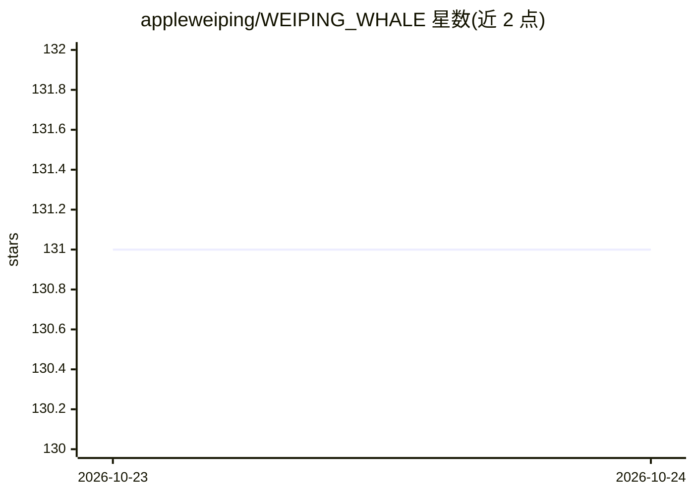

# appleweiping/WEIPING_WHALE

⭐ 131 · TypeScript · MIT · 推送 2026-10-22 · [GitHub](https://github.com/appleweiping/WEIPING_WHALE) · 个人维护

**面向 DeepSeek 模型的小型终端编码 agent**

TypeScript 编写的约 8,500 行终端编码 agent，是 Rust 项目 CodeWhale 设计的移植。面向 DeepSeek 的 OpenAI 兼容 API：读取仓库构建 repo map 与系统提示，循环执行工具调用；shell 命令先经正则审批（高风险拦截、删除/安装等需 /approve），文件修改默认仅生成补丁预览，由用户 /apply 应用。每轮前将工作区快照到独立 git 仓库支持 /undo 回滚，含会话 fork/backtrack/压缩、成本统计、子 agent、MCP 工具接入与可选 HTTP/SSE API。未发布到 npm，需从源码克隆运行；LSP 诊断仅覆盖 TS/JS 与 Python。

## 筛选速览

| 维度 | 判定 | 备注 |
|---|---|---|
| AI 角色 | `ai-native` | 本体是模型或模型工具 |
| 许可风险 | `permissive` | MIT |
| 部署形态 | `None` |  |
| 模型依赖 | locked-api |  |
| 硬件要求 | — | 无带数字的原话,不猜 |
| 安装摩擦 | `low` | 无编译、无系统依赖或容器化 |
| 成熟度 | — | 结构信号不足 |

## 能力要点

- 每轮前的独立 git 快照机制，任意一轮可 /undo 回滚
- shell 命令双层正则安全审批，文件编辑默认补丁预览而非直接写入
- --model auto 按消息关键词路由 flash/pro 模型与思考级别
- 会话 JSON 持久化与 /fork、/backtrack、/compact 压缩

## 适用场景

- 在终端里让 DeepSeek 模型阅读仓库、提修改建议并代跑命令
- 学习编码 agent 的核心循环实现（作者自述为理解此类工具而写）
- 通过 MCP 接入外部工具服务器扩展 agent 能力

## 场景标签

`编码 Agent` · 领域:编码与开发

## 证据(README 行号)

> L3: A small terminal coding agent for DeepSeek models: it reads your repository, runs
> L85: 4. **The loop.** `Agent.complete()` sends the messages plus every tool
> L133: - The client targets DeepSeek's OpenAI-compatible chat API; other endpoints set via

## 星数曲线

2026-10-23 131 → 2026-10-24 131（+0）

---
*卡片 v1 · prompt 1.4 · 生成 2026-10-23 · 置信度 high · 依据 README sha `4aaf462551a6` · [字段定义](../../DATASET.md)*
