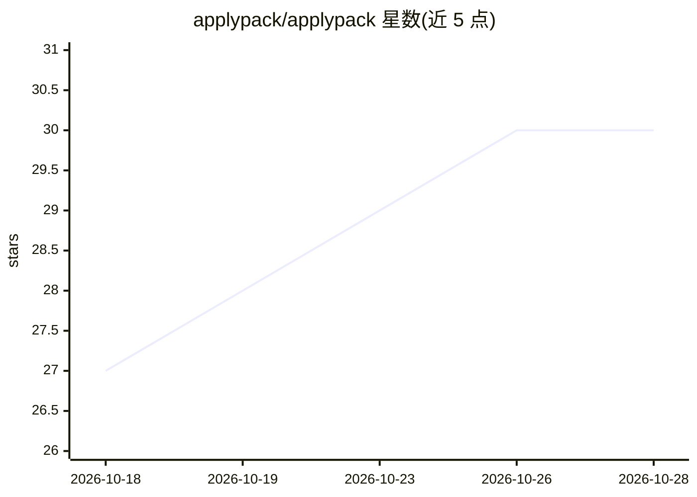

# applypack/applypack

⭐ 30 · TypeScript · MIT · 推送 2026-10-26 · [GitHub](https://github.com/applypack/applypack) · [官网](https://applypack.dev) · 个人维护

**自托管的求职全流程 AI 控制台：找岗位、验真伪、改简历、写信、跟踪**

运行在用户本机的开源求职工具：每小时抓取 33 类岗位源（12 家 ATS 厂商、聚合器、国家板块、RSS），经确定性过滤后由 AI 分类器对每帖打分并做真实性核查（legit/suspicious/fake）；对简历给出不可虚高的匹配分并一键应用改写，生成受事实门控的求职信，用看板跟踪投递。支持 7 个可切换 AI 后端与故障转移，数据存于用户自己的 Postgres，无遥测无订阅。自动投递默认关闭，任何信息不会代为提交。

## 筛选速览

| 维度 | 判定 | 备注 |
|---|---|---|
| AI 角色 | `ai-native` | 本体是模型或模型工具 |
| 许可风险 | `permissive` | MIT |
| 部署形态 | `self-host` | docker 或自建部署 |
| 模型依赖 | local-ok | 支持本地模型 |
| 硬件要求 | — | 无带数字的原话,不猜 |
| 安装摩擦 | `low` | 无编译、无系统依赖或容器化 |
| 成熟度 | — | 结构信号不足 |

## 能力要点

- 33 类岗位源每小时抓取 + 免费真实性核查并给出证据链接
- 模型标记事实、单元测试代码计算分数的简历匹配评分
- 求职信事实门控：简历中不存在的数字不会进入信件
- 7 个 AI 后端（CLI 订阅/API/本地 Ollama）自动故障转移

## 适用场景

- 软件工程师自动监控多国职位板并按匹配度收到提醒
- 针对单个岗位定制简历并导出带修改标记的 .docx
- 在一个看板里管理全部投递并追踪沉默申请
- 招聘方批量初筛一个文件夹的简历

## 场景标签

`网页抓取` `AI 写作` `数据分析` · 领域:效率与自动化

## 证据(README 行号)

> L56: - **🧠 A classifier with rules that burned me.** AI reads the full
> L107: - **💌 A cover letter that cannot invent.** Drafted from the posting, your

## 星数曲线

2026-10-18 27 → 2026-10-28 30（+3）

---
*卡片 v1 · prompt 1.4 · 生成 2026-10-26 · 置信度 high · 依据 README sha `292a71ba3198` · [字段定义](../../DATASET.md)*
