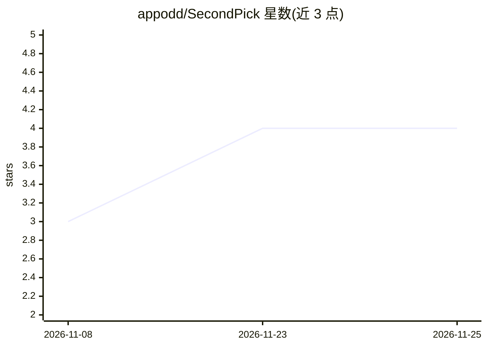

# appodd/SecondPick

⭐ 4 · Python · MIT · 推送 2026-11-22 · [GitHub](https://github.com/appodd/SecondPick) · 个人维护 · 中文 README

**自托管闲鱼二手选购工作台：监控采集商品并可选 AI 研究**

将二手选购流程组织为持续维护的选购项目：通过监控任务分轮采集闲鱼商品记录，按商品标识归并入库，支持搜索、筛选、收藏与候选并排比较。可选 AI 增强模式在本机 Codex CLI 驱动下生成目标整理、商品判断、研究报告与追问；自动研究需按项目单独授权，默认关闭。提供网页界面与本机 FastAPI 服务，数据存 SQLite，主要在 Windows 环境验证，闲鱼为非官方集成。

## 筛选速览

| 维度 | 判定 | 备注 |
|---|---|---|
| AI 角色 | `ai-enhanced` | 去掉 AI 部分产品仍成立 |
| 许可风险 | `permissive` | MIT |
| 部署形态 | `library` | 以包/库形式分发 |
| 模型依赖 | — | README 未给出锁定关系 |
| 硬件要求 | — | 无带数字的原话,不猜 |
| 安装摩擦 | `low` | 无编译、无系统依赖或容器化 |
| 成熟度 | `idea` | |

## 能力要点

- 基础模式仅监控采集与管理，无需配置 Codex CLI 或调用模型
- AI 增强模式提供目标整理、研究报告、逐项判断与统一 Agent 追问
- 采集与研究解耦，研究结果保留范围、证据与覆盖信息
- 可选视觉模型处理获准图片证据，需额外配置与授权

## 适用场景

- 长期监控闲鱼关键词并集中管理候选商品记录
- 在购买前整理报价、配置与待核实问题，按证据比较候选
- 让 AI 基于已保存的证据生成商品研究与信息缺口分析

## 场景标签

`网页抓取` · 领域:效率与自动化

## 证据(README 行号)

> L23: 它既可以作为**独立的监控采集与商品管理工具**，也可以作为**带 AI 能力的选购研究工作台**。是否使用分析，由你的需要和授权决定。
> L42: 无需安装或配置 Codex CLI。首次引导选择“基础模式”，完成应用基础、采集环境和闲鱼连接检查，即可开始创建项目。不授权自动研究，也不发起 AI 整理或手动分析请求时，不会为了分析商品调用模型。

## 星数曲线

2026-11-08 3 → 2026-11-25 4（+1）

---
*卡片 v1 · prompt 1.4 · 生成 2026-11-22 · 置信度 mid · 依据 README sha `c1b9263f100c` · [字段定义](../../DATASET.md)*
