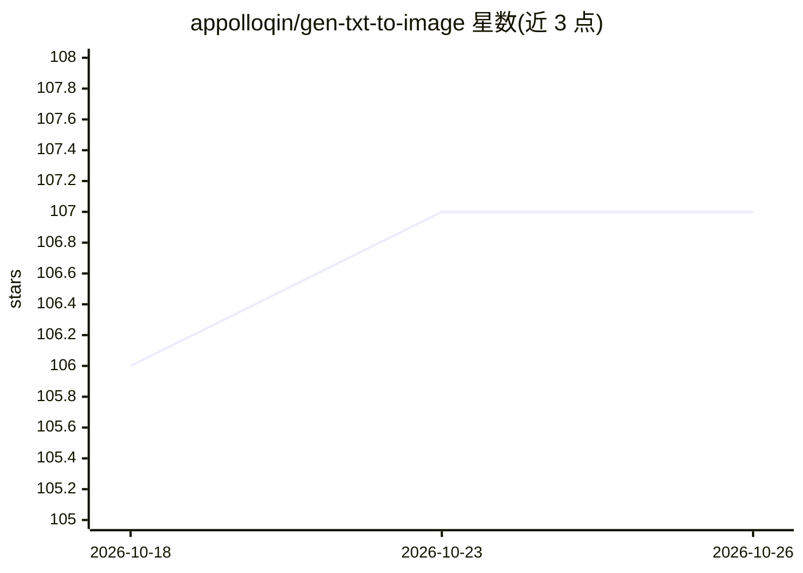

# appolloqin/gen-txt-to-image

⭐ 107 · Python · 推送 2026-06-28 · [GitHub](https://github.com/appolloqin/gen-txt-to-image) · 个人维护 · 中文 README

**文生视频应用：LLM 生成提示词驱动 Stable Diffusion 出图并合成视频**

面向小说推文、漫画视频制作的应用：用文心一言将文本转为 prompt，调用本地部署的 Stable Diffusion WebUI（端口 7860）生成图片，再用 OpenCV 将图片合成视频，输出到 output/image 与 output/video。安装需 Python 3.10 环境、pip 安装依赖并申请文心一言 token；其他大模型需自行开发适配。以 python main.py 方式本地运行。

## 筛选速览

| 维度 | 判定 | 备注 |
|---|---|---|
| AI 角色 | `ai-native` | 本体是模型或模型工具 |
| 许可风险 | `none` | — |
| 部署形态 | `library` | 以包/库形式分发 |
| 模型依赖 | — | README 未给出锁定关系 |
| 硬件要求 | — | 无带数字的原话,不猜 |
| 安装摩擦 | `low` | 无编译、无系统依赖或容器化 |
| 成熟度 | — | 结构信号不足 |

## 能力要点

- 文心一言生成 prompt，Stable Diffusion 生图，OpenCV 合成视频
- 支持文生图与图生视频的本地化私有部署流程
- 需本地部署 Stable Diffusion WebUI（端口 7860）

## 适用场景

- 将小说文本批量转换为漫画式推文视频
- 本地私有部署地生成图片与视频素材
- 基于 prompt 流水线做图文转视频创作

## 场景标签

`图像生成` `视频生成` · 领域:内容生成

## 证据(README 行号)

> L4: 一款文生视频应用，用于小说推文，生成漫画等视频。使用主流大模型，结合Stable Diffusion，实现文生图，图生视频本地化私有部署。
> L17: 使用文心一言，生成prompt，使用stable diffusion生成图片，使用opencv合成视频。

## 星数曲线

2026-10-18 106 → 2026-10-26 107（+1）

---
*卡片 v1 · prompt 1.4 · 生成 2026-10-23 · 置信度 high · 依据 README sha `9e0d7bf31239` · [字段定义](../../DATASET.md)*
