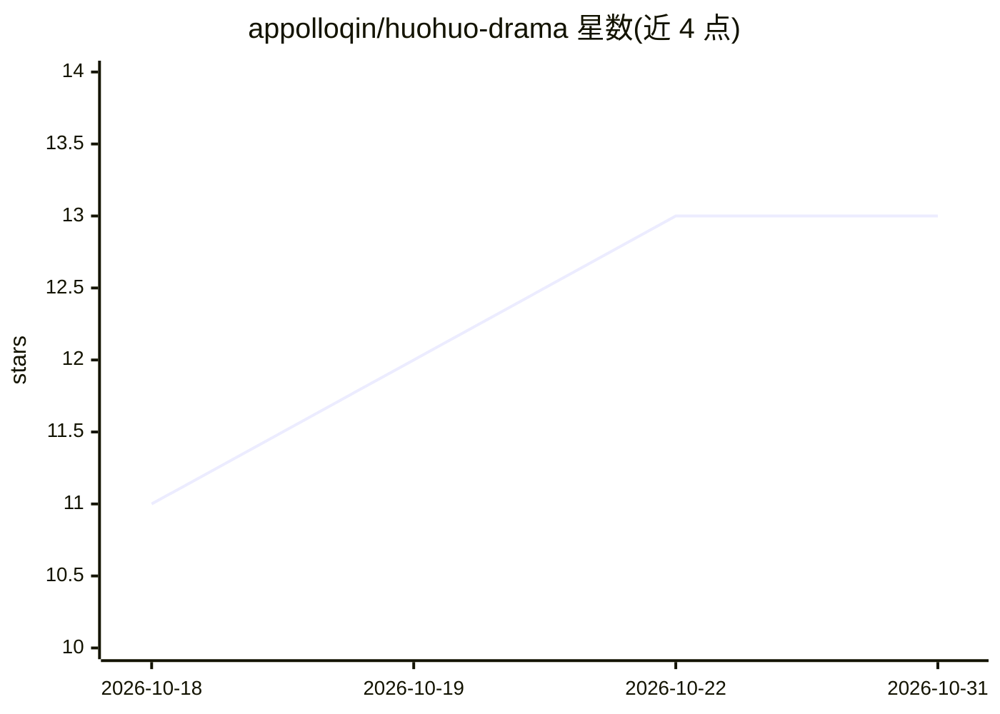

# appolloqin/huohuo-drama

⭐ 13 · TypeScript · 推送 2026-10-20 · [GitHub](https://github.com/appolloqin/huohuo-drama) · [官网](https://www.seeddrama.com/) · 个人维护 · 中文 README

**面向创作者的开源全栈 AI 短剧与 AI 小说创作平台**

全栈 SAAS 平台，在同一工作台内将原文推进为剧本、分镜、多模态素材并完成 TTS 配音、逐镜头 FFmpeg 合成与整集导出；每集支持 AI 视频与关键帧 Ken Burns 幻灯片两条流水线。小说模式由 Digital Writer 批量写作，默认因果链模式（章末变更记录：触发→过程→结果）加四层连贯性记忆保持长篇一致性；小说可一键导入短剧项目改写为剧本。另含 AI 文本检测与去 AI 化改写、积分制多渠道支付（Stripe/PayPal/PingPong/微信/支付宝）、uni-app 移动指挥端。基于 Nuxt 3 + Hono + Mastra，支持多厂商模型，Docker Compose 部署，FFmpeg 4.0+ 为必需依赖。

## 筛选速览

| 维度 | 判定 | 备注 |
|---|---|---|
| AI 角色 | `ai-native` | 本体是模型或模型工具 |
| 许可风险 | `none` | — |
| 部署形态 | `self-host` | docker 或自建部署 |
| 模型依赖 | local-ok | 支持本地模型 |
| 硬件要求 | — | 无带数字的原话,不猜 |
| 安装摩擦 | `low` | 无编译、无系统依赖或容器化 |
| 成熟度 | — | 结构信号不足 |

## 能力要点

- 短剧双流水线：AI 图生视频或关键帧 Ken Burns 幻灯片 + TTS + FFmpeg 合成导出
- Digital Writer 因果链模式与四层连贯性记忆支撑长篇小说连载
- 小说一键转短剧：章节/全书导入后自动改写为可拍摄剧本
- AI 文本检测与去 AI 化改写（文本/文件/音频/视频检测）
- 积分计费支持 Stripe/PayPal/PingPong/微信/支付宝，附 uni-app 移动端

## 适用场景

- 把小说或创意文本制作成带配音的短剧成片
- 连载长篇 AI 小说并保持人物与伏笔连贯
- 发布前检测并降低文本的 AI 痕迹
- 小团队以积分计费方式运营 AI 创作工作台

## 场景标签

`AI 写作` `视频生成` `语音合成` · 领域:内容生成

## 证据(README 行号)

> L12: **Huohuo Drama** is an open-source, full-stack **AI short-drama** and **AI novel** production platform. One workspa
> L16: **AI novel writing:** the built-in **Digital Writer** runs brief → draft → consistency review in batch. **Causal-ch

## 星数曲线

2026-10-18 11 → 2026-10-31 13（+2）

---
*卡片 v1 · prompt 1.4 · 生成 2026-10-31 · 置信度 high · 依据 README sha `1e22a46b9f02` · [字段定义](../../DATASET.md)*
