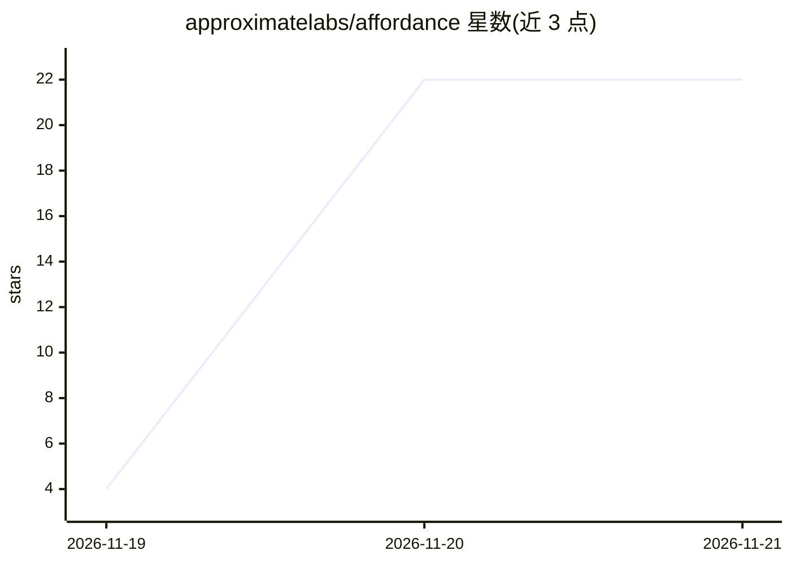

# approximatelabs/affordance

⭐ 22 · Rust · Apache-2.0 · 推送 2026-11-19 · [GitHub](https://github.com/approximatelabs/affordance) · [官网](https://affordance.rs) · 组织维护

**用 TSX 渲染状态为模型 token 的 agent 应用引擎**

一个 Rust 实现的模型应用引擎：开发者用 TSX 编写应用，将其状态渲染为模型实际读取的 token ID 序列，应用中保留的 `<aff>` 元素作为模型可调用的工具。引擎负责渲染、布局、效果与回放；内置 chat template（740 个模型与官方模板 ID 对齐）、token 预算布局、journal 确定性回放与多 agent 事件循环。通过 cargo 或 uvx 安装，可对接本地模型服务器或托管 API。v0.1 beta，Linux 开发为主，macOS 支持较新。

## 筛选速览

| 维度 | 判定 | 备注 |
|---|---|---|
| AI 角色 | `ai-ecosystem` | LLM/agent 周边工具 |
| 许可风险 | `permissive` | Apache-2.0 |
| 部署形态 | `library` | 以包/库形式分发 |
| 模型依赖 | local-ok | 支持本地模型 |
| 硬件要求 | — | 无带数字的原话,不猜 |
| 安装摩擦 | `low` | 无编译、无系统依赖或容器化 |
| 成熟度 | `idea` | |

## 能力要点

- TSX 渲染为精确 token ID，740 个模型与官方 chat template 对齐并可用 affordance check 逐一校验
- journal 确定性回放：崩溃后恢复或逐 turn 步进执行
- token 预算布局：按步丢弃旧历史、省略旧工具结果，保持 prompt 前缀稳定以利服务端缓存
- 单进程多 agent：事件循环、定时器、子实例与消息

## 适用场景

- 编写直接面向 token 序列的 agent 应用并精确控制上下文
- 对接本地 llama.cpp/Ollama/vLLM 服务器运行 agent
- 需要确定性回放与崩溃恢复的 agent 运行
- 用 OpenAI 兼容端点托管带超上下文记忆的聊天模型

## 场景标签

`多智能体` `Agent 框架` · 领域:Agent 开发

## 证据(README 行号)

> L6: An app is written in TSX, like a web page. It renders its state (a task, a shell's output,
> L9: state; the next render shows the result. The app owns its loop, its tools and its context policy;
> L41: Affordance is not React, Node or a prompt builder. TSX is a documented subset interpreted in

## 星数曲线

2026-11-19 4 → 2026-11-21 22（+18）

---
*卡片 v1 · prompt 1.4 · 生成 2026-11-20 · 置信度 high · 依据 README sha `32e33269d361` · [字段定义](../../DATASET.md)*
