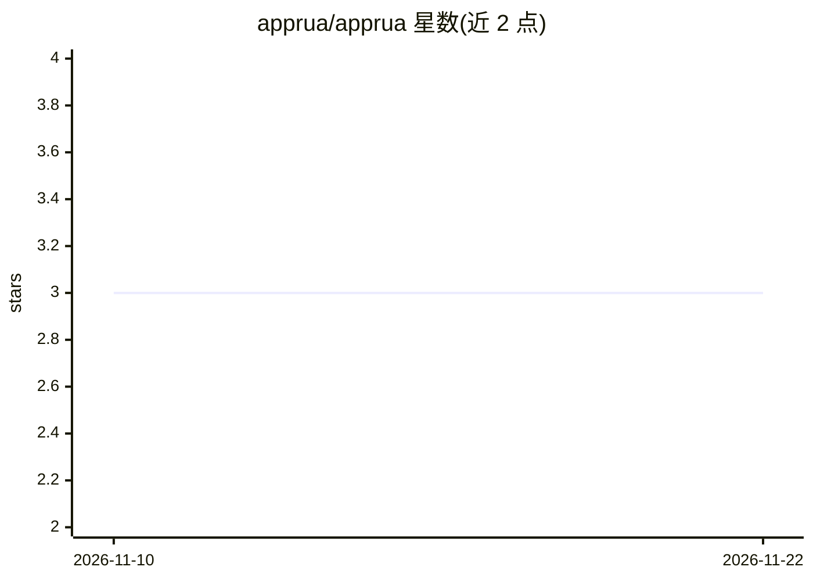

# apprua/apprua

⭐ 3 · TypeScript · AGPL-3.0 · 推送 2026-11-21 · [GitHub](https://github.com/apprua/apprua) · 个人维护 · 中文 README

**给非开发者的自托管发布平台：一句话让 AI 把应用部署到自己机器**

Apprua 是一个自托管的 PaaS，用于发布用 AI 聊天工具构建的应用：在 Windows PC 或 Linux 服务器安装后，通过 MCP 连接器（stdio MCP server）接入 Claude、OpenAI Codex、Cursor、VS Code 等 AI 应用，用户在聊天中说一句发布指令，系统完成打包、检查、构建与运行。底层引擎为 Coolify，经驱动接口封装可替换。内置登录保护、每应用独立内存空间、密钥泄露检查（拒绝含 API key/私钥/.env 的发布）、版本存档与回滚。应用数据留在本机，无自有云；面向几十人规模的小型应用，不适合高流量站点、本地模型运行与视频处理。

## 筛选速览

| 维度 | 判定 | 备注 |
|---|---|---|
| AI 角色 | `ai-enhanced` | 去掉 AI 部分产品仍成立 |
| 许可风险 | `viral` | AGPL-3.0 |
| 部署形态 | `library` | 以包/库形式分发 |
| 模型依赖 | — | README 未给出锁定关系 |
| 硬件要求 | — | 无带数字的原话,不猜 |
| 安装摩擦 | `low` | 无编译、无系统依赖或容器化 |
| 成熟度 | — | 结构信号不足 |

## 能力要点

- MCP 连接器接入多种 AI 应用，聊天指令完成发布、更新、暂停与回滚
- 发布前检查并拒绝含常见格式密钥（API key、私钥、.env）的文件
- 每次发布保存版本，支持一句话回滚与代码下载
- 支持个人与团队两种档案，含账号、限额与管理员

## 适用场景

- 给 AI 生成的购物清单、计算器、表单一个团队可访问的地址
- 公司提供官方发布入口，给内部 AI 应用归属与登录，减少影子 IT
- 把原型快速给他人试用，可随时回退到旧版本

## 场景标签

 · 领域:应用部署/自托管平台

## 证据(README 行号)

> L10: A shopping list, a quote calculator, a tool for your team: the AI wrote it and it works, but it lives in a chat or 
> L59: AI app ──MCP──▶ Apprua connector (on your PC) ──key──▶ Apprua (your PC or server) ──▶ engine (Coolify) ──▶ your app

## 星数曲线

2026-11-10 3 → 2026-11-22 3（+0）

---
*卡片 v1 · prompt 1.4 · 生成 2026-11-22 · 置信度 high · 依据 README sha `c442c735412b` · [字段定义](../../DATASET.md)*
