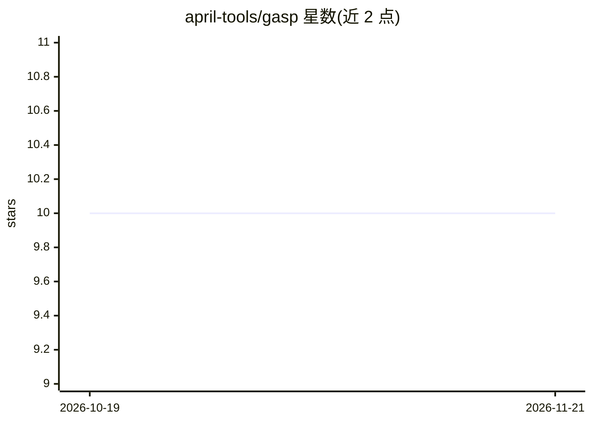

# april-tools/gasp

⭐ 10 · Python · MIT · 推送 2026-05-28 · [GitHub](https://github.com/april-tools/gasp) · 个人维护

**面向 wmi-pa 的 GPU 加速 WMI 多项式积分后端**

GASP! 是一个 Python 包，为加权模型积分（WMI）提供 GPU 加速的积分后端，可作为 wmi-pa 框架的独立替换后端（drop-in backend），替代 LATTE。主要使用方式是通过 NumericalSymbIntegratorPA 接入 wmipa API。README 称在并行集成多个单项式时性能提升幅度更大。提供基于引用的论文出处（神经符号约束满足的概率层），安装方式为 git+pip 从源码安装。

## 筛选速览

| 维度 | 判定 | 备注 |
|---|---|---|
| AI 角色 | `ai-native` | 本体是模型或模型工具 |
| 许可风险 | `permissive` | MIT |
| 部署形态 | `library` | 以包/库形式分发 |
| 模型依赖 | — | README 未给出锁定关系 |
| 硬件要求 | — | 无带数字的原话,不猜 |
| 安装摩擦 | `low` | 无编译、无系统依赖或容器化 |
| 成熟度 | — | 结构信号不足 |

## 能力要点

- 作为 wmi-pa 的 drop-in 后端，可替换 LATTE
- 基于 GPU 加速 WMI 多项式积分
- 通过 NumericalSymbIntegratorPA 接入 wmipa API
- README 附带论文引用（ICML 式 inproceedings 条目）

## 适用场景

- 为神经符号约束满足层计算加权模型积分
- 在需要并行集成大量单项式时替代现有积分后端
- 在已有 wmipa 工作流中切换 GPU 积分后端

## 场景标签

 · 领域:机器学习/符号计算

## 证据(README 行号)

> L4: This repository is the implementation of GASP!, the GPU Accelerated Simplical Integrator, as a stand-alone drop-in b
> L20: The main usage is via `NumericalSymbIntegratorPA`, which hooks into the `wmipa` API.

## 星数曲线

2026-10-19 10 → 2026-11-21 10（+0）

---
*卡片 v1 · prompt 1.4 · 生成 2026-11-20 · 置信度 mid · 依据 README sha `2bf9a8d28f50` · [字段定义](../../DATASET.md)*
