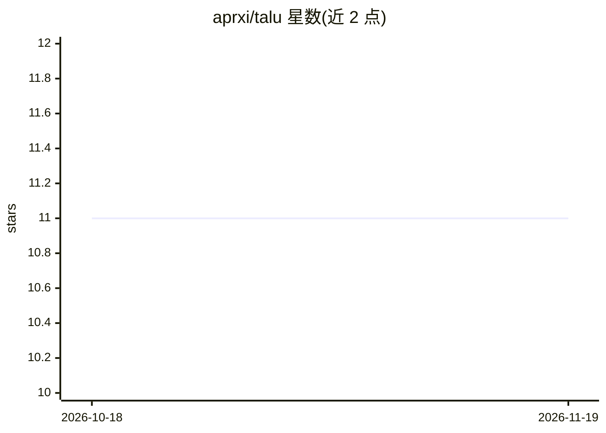

# aprxi/talu

⭐ 11 · Zig · MIT · 推送 2026-05-29 · [GitHub](https://github.com/aprxi/talu) · [官网](https://docs.talu.dev) · 个人维护

**本地优先的单二进制 LLM 推理运行时：CLI/Python/HTTP 多形态**

以 Zig 从零实现的本地推理引擎，无 PyTorch 等重运行时依赖；从 HuggingFace 下载模型后可在 CLI、Python API、HTTP 服务器和插件化 Web UI 中运行。提供结构化输出（预编译语法+流式校验）、持久化会话、嵌入向量检索、工具调用，内置 4-bit/8-bit 分组仿射量化；也支持将请求路由到远端 OpenAI 兼容端点，共用同一 API 契约。后端目前为 CPU 与 Metal。

## 筛选速览

| 维度 | 判定 | 备注 |
|---|---|---|
| AI 角色 | `ai-ecosystem` | LLM/agent 周边工具 |
| 许可风险 | `permissive` | MIT |
| 部署形态 | `library` | 以包/库形式分发 |
| 模型依赖 | — | README 未给出锁定关系 |
| 硬件要求 | — | 无带数字的原话,不猜 |
| 安装摩擦 | `medium` | 含编译或系统依赖之一 |
| 成熟度 | — | 结构信号不足 |

## 能力要点

- 单二进制分发，CLI/Python/HTTP/Web UI 共享同一核心运行时
- 内置 4-bit 与 8-bit 分组仿射量化（gaf4/gaf8 方案）
- 结构化输出：预编译语法与流式校验
- 本地模型与远端 OpenAI 兼容端点的统一路由

## 适用场景

- 在本地命令行下载、量化并运行开源模型进行对话
- 通过 Python 库在应用中嵌入流式聊天与嵌入检索
- 用内置 HTTP 服务器与聊天 UI 搭建本地模型服务
- 同一套 API 在本地模型与远端端点间切换

## 场景标签

`推理引擎` `模型量化` · 领域:训练与推理

## 证据(README 行号)

> L3: **Full-Stack Inference for Local AI.**
> L5: Talu is a local-first inference engine built from scratch in Zig — no PyTorch, Transformers, or other heavyweight ru
> L9: Distributed as a single binary, talu exposes thin bindings over a shared core runtime. The Web UI runs on the same s
> L17: - **Backends** — CPU and Metal (CUDA planned); local models and remote OpenAI-compatible endpoints

## 星数曲线

2026-10-18 11 → 2026-11-19 11（+0）

---
*卡片 v1 · prompt 1.4 · 生成 2026-11-18 · 置信度 high · 依据 README sha `5abec30d7c39` · [字段定义](../../DATASET.md)*
