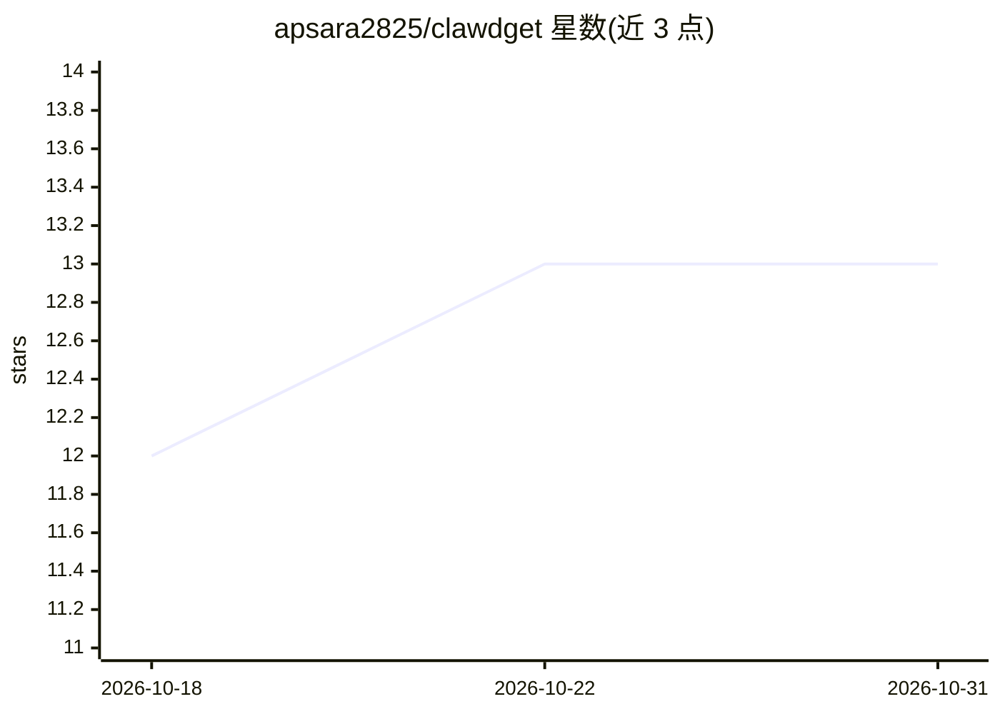

# apsara2825/clawdget

⭐ 13 · C · MIT · 推送 2026-09-23 · [GitHub](https://github.com/apsara2825/clawdget) · 个人维护 · 中文 README

**纯 C 编写的嵌入式 Linux 端 AI agent，550KB 二进制**

面向路由器、开发板、NAS 等资源受限 Linux 设备的 AI agent，C99 单二进制，550KB（静态约 2MB）、内存占用低于 1MB。通过任意 OpenAI 兼容端点接入 LLM（DeepSeek、Qwen、Ollama、vLLM 等），提供 agent 循环、7 个内置工具（执行命令、读写文件、HTTP 抓取、系统信息）、Markdown 技能机制、会话管理与流式输出，可选编译接入微信与 Telegram 通道。在 MT7628/OpenWrt 上验证。默认每个 shell 命令需 y/n 确认，文件操作限定在工作区内。

## 筛选速览

| 维度 | 判定 | 备注 |
|---|---|---|
| AI 角色 | `ai-native` | 本体是模型或模型工具 |
| 许可风险 | `permissive` | MIT |
| 部署形态 | `None` |  |
| 模型依赖 | local-ok | 支持本地模型 |
| 硬件要求 | — | 无带数字的原话,不猜 |
| 安装摩擦 | `low` | 无编译、无系统依赖或容器化 |
| 成熟度 | — | 结构信号不足 |

## 能力要点

- C99 单二进制，550KB–2MB，内存 <1MB，无 Python 运行时依赖
- 7 个内置工具 + Markdown 技能（SKILL.md 注入系统提示）
- 任意 OpenAI 兼容端点作为后端
- 可选微信（iLink API）与 Telegram 通道编译接入

## 适用场景

- 在路由器或开发板上跑一个能执行命令、读写文件的 AI agent
- 通过微信或 Telegram 远程对话控制设备
- 给老旧 mini PC / NAS 加装 AI 助手

## 场景标签

`AI 助手` · 领域:对话与助手

## 证据(README 行号)

> L20: > 🦴 **clawdget** has exactly one goal: **cram an AI agent into every
> L63: - **7 built-in tools** — `exec` `read_file` `write_file` `edit_file` `list_dir` `http_fetch` `sysinfo`

## 星数曲线

2026-10-18 12 → 2026-10-31 13（+1）

---
*卡片 v1 · prompt 1.4 · 生成 2026-10-31 · 置信度 high · 依据 README sha `9ced772a477e` · [字段定义](../../DATASET.md)*
