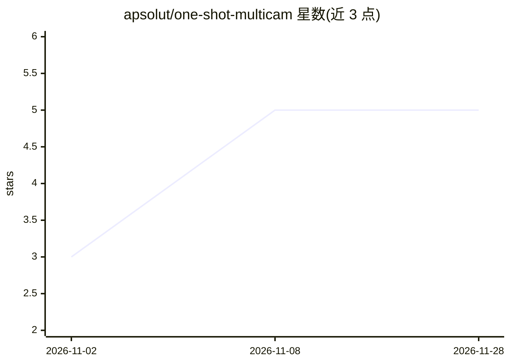

# apsolut/one-shot-multicam

⭐ 5 · Python · MIT · 推送 2026-10-31 · [GitHub](https://github.com/apsolut/one-shot-multicam) · [官网](https://multicam.apsolut.dev) · 个人维护

**单段自拍视频生成多机位剪辑的 ComfyUI 视频重拍工具**

面向有自拍口播视频的创作者：以真实素材为 CAM A，通过 ComfyUI 上的 LTX-2.3 + CrossView IC-LoRA（视频到视频重拍）或 Qwen-Image-Edit 角度图 + LTX-2.3 ID LoRA 路径生成 CAM B/C 虚拟机位，按 faster-whisper 词级时间戳在语音词边界处切换镜头，保留原始音频。提供 Web 应用、CLI（analyze/plan/prep/submit/align/assemble）与结果剪辑编辑器。生成任务在 Comfy Cloud 上付费运行，本地无 GPU 要求；MIT 许可。

## 筛选速览

| 维度 | 判定 | 备注 |
|---|---|---|
| AI 角色 | `ai-native` | 本体是模型或模型工具 |
| 许可风险 | `permissive` | MIT |
| 部署形态 | `self-host` | docker 或自建部署 |
| 模型依赖 | — | README 未给出锁定关系 |
| 硬件要求 | — | 无带数字的原话,不猜 |
| 安装摩擦 | `low` | 无编译、无系统依赖或容器化 |
| 成熟度 | — | 结构信号不足 |

## 能力要点

- LTX-2.3 22B + CrossView IC-LoRA 视频到视频重拍，音频隐含时间锁定（0–1 帧延迟）
- 按 Whisper 词级时间戳自动剪辑，支持逐镜头切换/删除/重掷
- Talk/Music/Scene/Dub 多模式与分享包导出
- 本地 FastAPI 服务器 + Comfy Cloud API key，托管部署含限额护栏

## 适用场景

- 把一段口播自拍视频剪成多机位节目效果
- 为视频生成侧面、3/4、广角等额外机位镜头
- 按节拍为音乐视频插入补充镜头

## 场景标签

`视频生成` · 领域:内容生成

## 证据(README 行号)

> L3: **One selfie take → a multicam edit.** Your real footage is **CAM A**. ComfyUI **re-shoots that
> L72: Needs Python 3.10+ and `ffmpeg` on PATH. No local GPU: generation runs on Comfy Cloud.
> L81: multicam serve                      # → http://127.0.0.1:8787

## 星数曲线

2026-11-02 3 → 2026-11-28 5（+2）

---
*卡片 v1 · prompt 1.4 · 生成 2026-11-22 · 置信度 high · 依据 README sha `2374b00b3761` · [字段定义](../../DATASET.md)*
