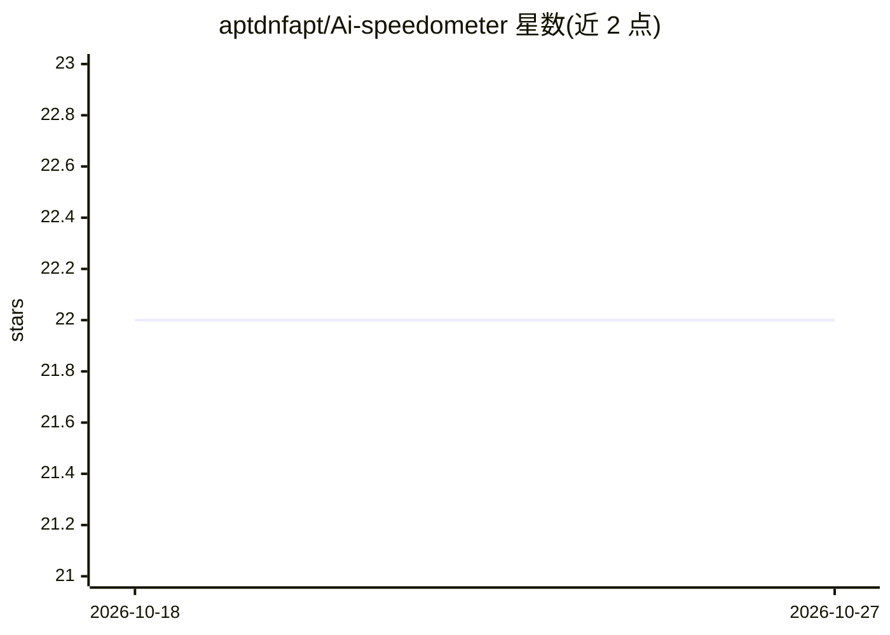

# aptdnfapt/Ai-speedometer

⭐ 22 · TypeScript · 推送 2026-07-23 · [GitHub](https://github.com/aptdnfapt/Ai-speedometer) · 个人维护

**跨多个 AI 提供商的模型速度基准测试 CLI（TTFT/TPS/F1000）**

终端基准测试工具，monorepo 分为带 TUI 的完整版（需 Bun 1.0+）与面向 Node.js 18+ 的 headless 版：测量 TTFT、总耗时、Tokens/秒、F1000（1000 次 agentic 请求耗时）及 token 用量，支持并行测试多个模型、CI/CD JSON 输出、OpenAI 兼容 REST API 提供商，兼容 opencode 的提供商/模型配置与 auth.json，需自备各提供商 API key。

## 筛选速览

| 维度 | 判定 | 备注 |
|---|---|---|
| AI 角色 | `ai-ecosystem` | LLM/agent 周边工具 |
| 许可风险 | `none` | — |
| 部署形态 | `library` | 以包/库形式分发 |
| 模型依赖 | — | README 未给出锁定关系 |
| 硬件要求 | — | 无带数字的原话,不猜 |
| 安装摩擦 | `low` | 无编译、无系统依赖或容器化 |
| 成熟度 | — | 结构信号不足 |

## 能力要点

- TTFT、Tokens/秒、F1000（1000 次 agentic 请求耗时）等多指标测量
- 兼容 opencode 的提供商/模型配置与认证文件，无需重复添加
- headless 版支持 Node.js 18+，输出 JSON 适配 CI/CD
- 支持所有 OpenAI 兼容提供商的 REST API 基准测试

## 适用场景

- 对比不同模型/提供商的首 token 延迟与吞吐速度
- 在 CI/CD 中自动化跑模型性能基准
- 评估编码助手场景的真实 agentic 请求性能（F1000）

## 场景标签

`模型评测` · 领域:评测与运维

## 证据(README 行号)

> L3: A CLI tool for benchmarking AI models across multiple providers with parallel execution and performance metrics. ful
> L49: - **TTFT** (Time to First Token) - How fast the first response token arrives
> L83: - **Headless Mode** - Run benchmarks without interactive UI via CLI flags — outputs JSON, perfect for CI/CD

## 星数曲线

2026-10-18 22 → 2026-10-27 22（+0）

---
*卡片 v1 · prompt 1.4 · 生成 2026-10-27 · 置信度 high · 依据 README sha `d70135b468e4` · [字段定义](../../DATASET.md)*
