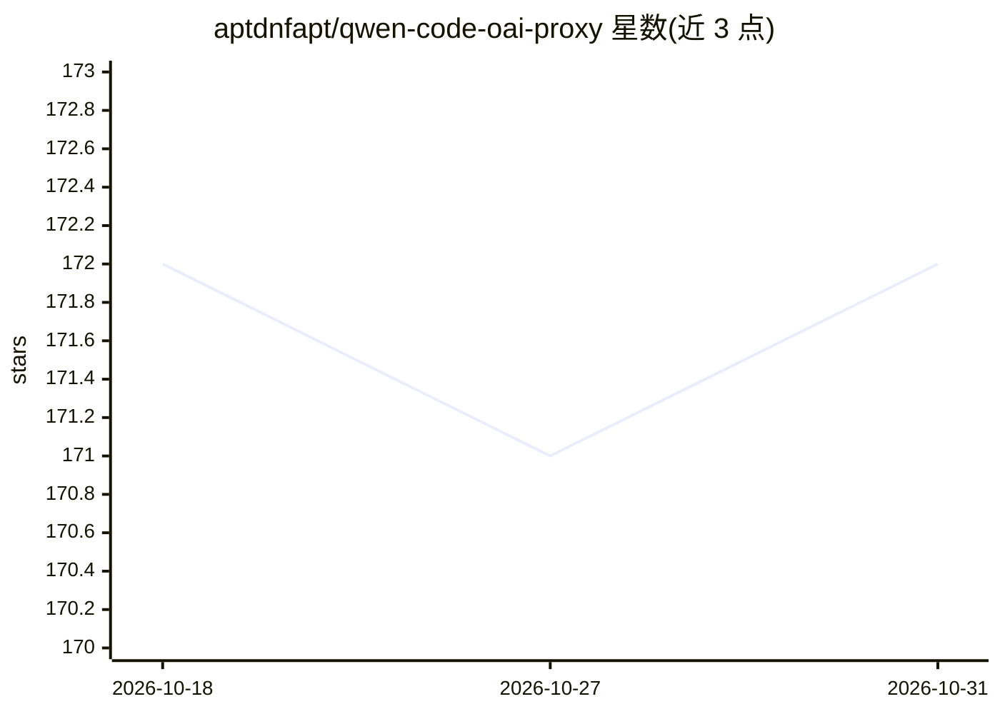

# aptdnfapt/qwen-code-oai-proxy

⭐ 172 · TypeScript · 推送 2026-04-16 · [GitHub](https://github.com/aptdnfapt/qwen-code-oai-proxy) · 个人维护

**将 Qwen 模型转成 OpenAI 兼容 API 的本地代理服务器（已停止维护）**

本地代理服务器，读取 Qwen CLI 的 OAuth 凭据，在 8080 端口提供 OpenAI 兼容的 /v1/chat/completions 接口，使 opencode、cline、Roo Code 等客户端可调用 Qwen 模型。支持多账户轮换、工具调用、流式输出、网络搜索接口与 MCP 服务器，附 TUI 管理界面。README 顶部声明项目已弃置：Qwen 免费额度终止，使用会得到 401 错误。提供 npm 全局安装、Docker 与源码运行三种方式。

## 筛选速览

| 维度 | 判定 | 备注 |
|---|---|---|
| AI 角色 | `ai-ecosystem` | LLM/agent 周边工具 |
| 许可风险 | `none` | — |
| 部署形态 | `self-host` | docker 或自建部署 |
| 模型依赖 | — | README 未给出锁定关系 |
| 硬件要求 | — | 无带数字的原话,不猜 |
| 安装摩擦 | `low` | 无编译、无系统依赖或容器化 |
| 成熟度 | — | 结构信号不足 |

## 能力要点

- OpenAI 兼容代理端点，含流式与工具调用
- 多账户 round-robin 轮换与令牌自动刷新
- 附带网络搜索接口（免费配额）与 MCP 服务器（SSE）
- 终端 TUI 管理界面，支持主题切换与鼠标操作

## 适用场景

- 让 opencode/cline 等只支持 OpenAI API 的工具调用 Qwen 模型
- 多个 Qwen 账户间轮换以分摊请求配额
- 为 MCP 客户端提供网页搜索工具

## 场景标签

`模型网关` · 领域:Agent 开发

## 证据(README 行号)

> L3: Works with opencode, crush, claude code router, roo code, cline and anything that speaks the OpenAI API. Has tool ca
> L138: - `POST /v1/chat/completions` — Chat completions (streaming + non-streaming)

## 星数曲线

2026-10-18 172 → 2026-10-31 172（+0）

---
*卡片 v1 · prompt 1.4 · 生成 2026-10-22 · 置信度 high · 依据 README sha `2daf8320e9ac` · [字段定义](../../DATASET.md)*
