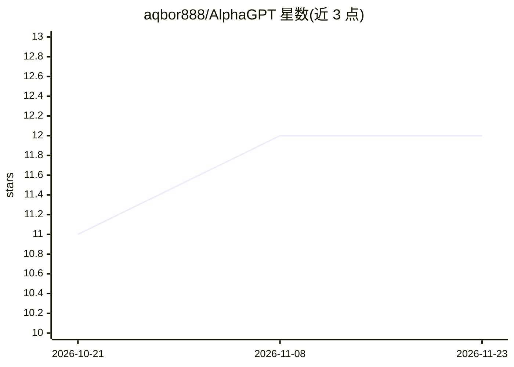

# aqbor888/AlphaGPT

⭐ 12 · Python · Apache-2.0 · 推送 2026-10-12 · [GitHub](https://github.com/aqbor888/AlphaGPT) · [官网](https://aqbor888.github.io) · 个人维护

**面向交易者的金融因子挖掘桌面应用：用符号回归挖掘 A 股与加密市场因子**

AlphaGPT 是一款下载即用的桌面应用，使用符号回归与深度学习技术在中文股票市场和加密货币市场挖掘金融因子；用户导入 CSV 数据、选择分析类型后查看结果并导出。无需编程知识，界面简单。支持 Windows/macOS/Linux 安装包，要求至少 4GB 内存与稳定网络连接，磁盘占用约 10 MB 起。README 未给出技术架构细节，也未展示核心算法代码。

## 筛选速览

| 维度 | 判定 | 备注 |
|---|---|---|
| AI 角色 | `ai-native` | 本体是模型或模型工具 |
| 许可风险 | `permissive` | Apache-2.0 |
| 部署形态 | `desktop` | 安装包/桌面程序 |
| 模型依赖 | — | README 未给出锁定关系 |
| 硬件要求 | — | 无带数字的原话,不猜 |
| 安装摩擦 | `low` | 无编译、无系统依赖或容器化 |
| 成熟度 | — | 结构信号不足 |

## 能力要点

- 符号回归挖掘股票与加密市场因子
- CSV 数据导入与多种格式结果导出
- 提供 Windows/macOS/Linux 安装包，无需编程知识

## 适用场景

- 挖掘中国股市与加密市场的金融因子
- 将交易数据导出报告用于策略分析
- 无编程背景下做金融数据洞察

## 场景标签

`金融量化` `数据分析` · 领域:效率与自动化

## 证据(README 行号)

> L7: AlphaGPT uses symbolic regression to efficiently mine factors in the Chinese stock market and cryptocurrency markets
> L14: - A computer with Windows, macOS, or Linux.

## 星数曲线

2026-10-21 11 → 2026-11-23 12（+1）

---
*卡片 v1 · prompt 1.4 · 生成 2026-11-18 · 置信度 mid · 依据 README sha `f1ae320abb3e` · [字段定义](../../DATASET.md)*
