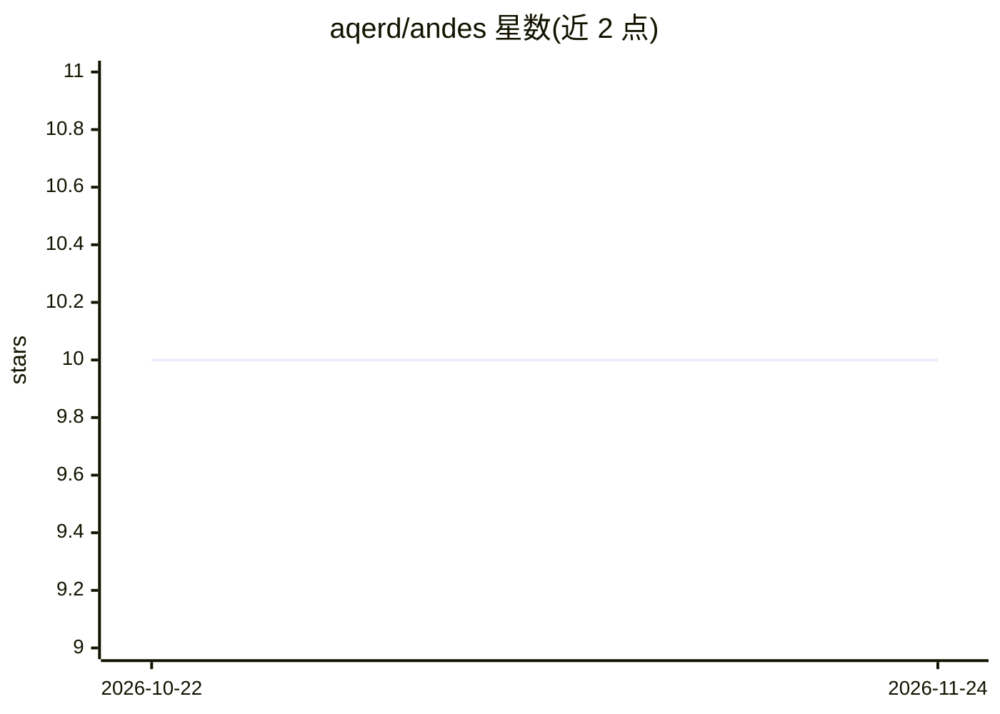

# aqerd/andes

⭐ 10 · TypeScript · MIT · 推送 2026-05-06 · [GitHub](https://github.com/aqerd/andes) · [官网](https://marketplace.visualstudio.com/items?itemName=aqerd.andes-rs) · 个人维护

**VS Code 扩展：为本地 Ollama 模型提供 UI 界面**

面向 VS Code 及其分支（Cursor、Windsurf、Trae 等）的扩展，为 Ollama 本地模型提供图形界面：管理已安装的本地模型、进行 AI 对话，并展示模型的推理过程与决策。无鉴权设计，直接从 TypeScript 请求 Ollama 端点，Markdown 转 HTML 由 Golang API 处理。可通过 VS Marketplace 或 Open VSX 安装，也可从源码构建测试。README 声明该项目已不再积极维护。

## 筛选速览

| 维度 | 判定 | 备注 |
|---|---|---|
| AI 角色 | `ai-ecosystem` | LLM/agent 周边工具 |
| 许可风险 | `permissive` | MIT |
| 部署形态 | `None` |  |
| 模型依赖 | local-ok | 支持本地模型 |
| 硬件要求 | — | 无带数字的原话,不猜 |
| 安装摩擦 | `low` | 无编译、无系统依赖或容器化 |
| 成熟度 | — | 结构信号不足 |

## 能力要点

- 在编辑器内管理本地已安装的 Ollama 模型
- 与本地模型对话并观察其推理过程与决策
- 无鉴权设计，直接请求 Ollama 端点
- 支持 VS Code 及 Cursor/Windsurf/Trae 等分支

## 适用场景

- 在 VS Code 里不离开编辑器就能与本地 Ollama 模型聊天
- 集中管理本机已下载的 Ollama 模型
- 查看模型的推理过程来调试提示词

## 场景标签

`AI 助手` · 领域:对话与助手

## 证据(README 行号)

> L12: A Visual Studio Code (or Cursor, Windsurf etc) extension that provides a local UI interface for Ollama models.
> L36: - Manage your installed Ollama models locally;

## 星数曲线

2026-10-22 10 → 2026-11-24 10（+0）

---
*卡片 v1 · prompt 1.4 · 生成 2026-11-20 · 置信度 high · 依据 README sha `f6abcda3a224` · [字段定义](../../DATASET.md)*
