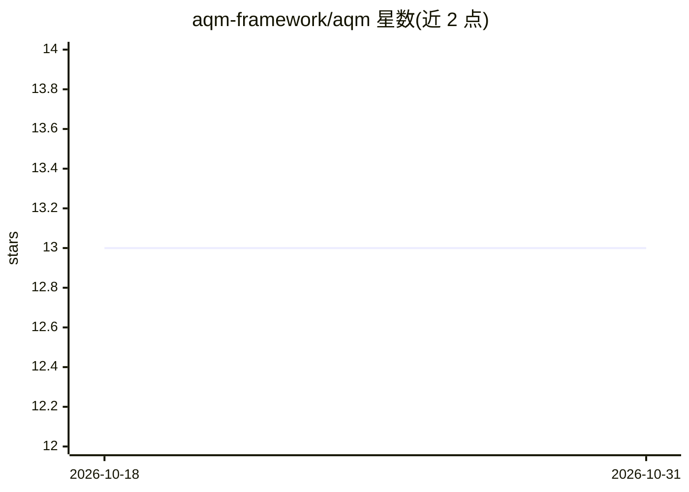

# aqm-framework/aqm

⭐ 13 · Python · MIT · 推送 2026-03-27 · [GitHub](https://github.com/aqm-framework/aqm) · 组织维护 · 中文 README

**YAML 定义多 AI agent 流水线的编排框架，经队列传递任务**

面向开发者的 agent 编排框架：用单个 YAML 文件定义多 agent 团队，任务经显式队列在 agent 间流转，或通过多轮 session 节点让 agent 辩论至达成共识（vote/moderator_decides）。每个 agent 可绑定不同的 LLM CLI 运行时（Claude/Gemini/Codex），以子进程方式调用已有 CLI 订阅，无需 API key 与 SDK。本地以 SQLite 运行，提供 pip 安装、CLI 命令、Web 面板与可分享的流水线注册表。限制：需 Python 3.11+ 且至少安装一个 LLM CLI。

## 筛选速览

| 维度 | 判定 | 备注 |
|---|---|---|
| AI 角色 | `ai-ecosystem` | LLM/agent 周边工具 |
| 许可风险 | `permissive` | MIT |
| 部署形态 | `library` | 以包/库形式分发 |
| 模型依赖 | locked-api |  |
| 硬件要求 | — | 无带数字的原话,不猜 |
| 安装摩擦 | `low` | 无编译、无系统依赖或容器化 |
| 成熟度 | — | 结构信号不足 |

## 能力要点

- YAML 定义流水线，agent 间显式队列传递与条件 handoff 路由
- 多 LLM 运行时混用（Claude/Gemini/Codex CLI，子进程调用，无需 API key）
- session 共识机制与 chunk 任务分解跟踪
- 5 种 context 策略（实测 55-85% token 节省）与阶段快照重启

## 适用场景

- 用 YAML 编排多角色 agent 流水线自动完成开发任务
- 让多个专家 agent 多轮辩论达成架构决策
- 通过 aqm search/pull 复用社区流水线

## 场景标签

`Agent 框架` `多智能体` · 领域:Agent 开发

## 证据(README 行号)

> L7: An orchestration framework where multiple AI agents pass tasks through **explicit queues** — or **discuss in real-ti
> L30: pip install aqm && aqm init && aqm run "Add JWT authentication"
> L59: No API keys or SDK setup needed — aqm runs CLI tools as subprocesses. You pay for the CLI subscriptions you already

## 星数曲线

2026-10-18 13 → 2026-10-31 13（+0）

---
*卡片 v1 · prompt 1.4 · 生成 2026-10-31 · 置信度 mid · 依据 README sha `6897554f929a` · [字段定义](../../DATASET.md)*
