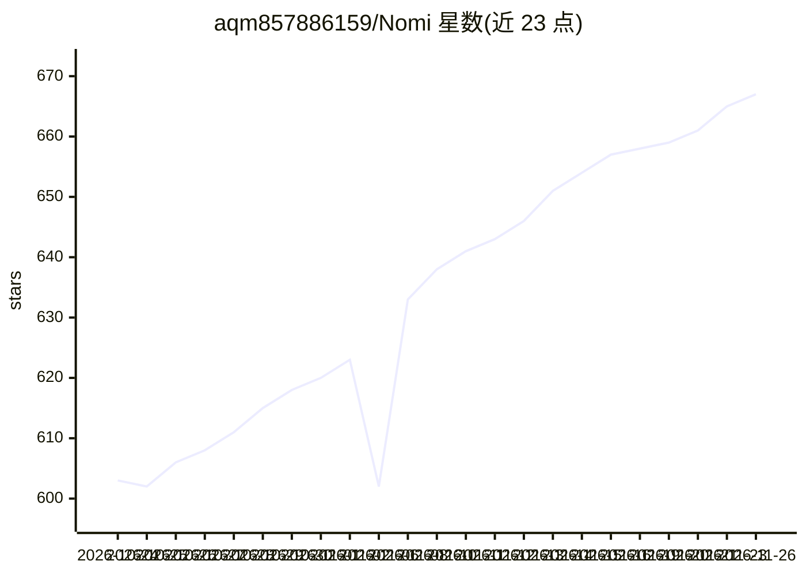

# aqm857886159/Nomi

⭐ 667 · TypeScript · AGPL-3.0 · 推送 2026-11-25 · [GitHub](https://github.com/aqm857886159/Nomi) · [官网](https://nomiaqm.com) · 个人维护 · 中文 README

**本地优先的开源 AI 视频工作室：Agent 分镜生成到时间线剪辑**

桌面端 AI 视频工作室：内置 Agent 将一句话需求拆成镜头，生成关键帧与视频并铺到可编辑时间线，导出 MP4。模型由用户自接（Seedance、Kling、Wan、Hailuo、Nano Banana、GPT Image 等，经 APIMart/Kie.ai/Volcengine/ModelScope/OpenAI 兼容端点或本地 ComfyUI），按服务商原价直接付费，产品本身免费、无账号、默认不遥测。提供 24 个 MCP 工具，可被 Claude Code/Codex/Cursor 驱动；支持故事板、角色参考卡锁定、手机取景的 3D 排布。提供 macOS/Windows 安装包，开发需 Node.js 20+ 与 pnpm；macOS 构建未经 Apple 签名公证。

## 筛选速览

| 维度 | 判定 | 备注 |
|---|---|---|
| AI 角色 | `ai-native` | 本体是模型或模型工具 |
| 许可风险 | `viral` | AGPL-3.0 |
| 部署形态 | `desktop` | 安装包/桌面程序 |
| 模型依赖 | — | README 未给出锁定关系 |
| 硬件要求 | — | 无带数字的原话,不猜 |
| 安装摩擦 | `low` | 无编译、无系统依赖或容器化 |
| 成熟度 | — | 结构信号不足 |

## 能力要点

- Agent 从需求生成关键帧、视频并铺时间线，导出 MP4
- 24 个 MCP 工具，Claude Code/Codex/Cursor 可驱动全流程
- 本地优先：项目、提示词与密钥留在本机，无账号与遥测
- 通过 APIMart/Kie.ai/Volcengine/ModelScope/OpenAI 兼容端点或本地 ComfyUI 接任意模型

## 适用场景

- 用自己的 API key 按原价做 AI 视频，避免转售加价
- 让 Claude Code/Cursor 通过 MCP 编排分镜与生成流程
- 用故事板和角色参考卡保持多镜头人物一致
- 纯本地管理项目素材与成片导出

## 场景标签

`图像生成` `视频生成` · 领域:内容生成

## 证据(README 行号)

> L28: - **What it is:** a desktop AI video studio. Its agent splits your story into shots, generates keyframes and video,
> L31: - **Models:** Seedance, Kling, Wan, Hailuo, Nano Banana, GPT Image and more, through APIMart, Kie.ai, Volcengine, M
> L131: Nomi ships an MCP server with 24 MCP tools, so Claude Code, Codex, or Cursor can drive it — generate, arrange, and

## 星数曲线

2026-10-24 603 → 2026-11-26 667（+64）

---
*卡片 v1 · prompt 1.4 · 生成 2026-11-26 · 置信度 mid · 依据 README sha `9b30357c798c` · [字段定义](../../DATASET.md)*
