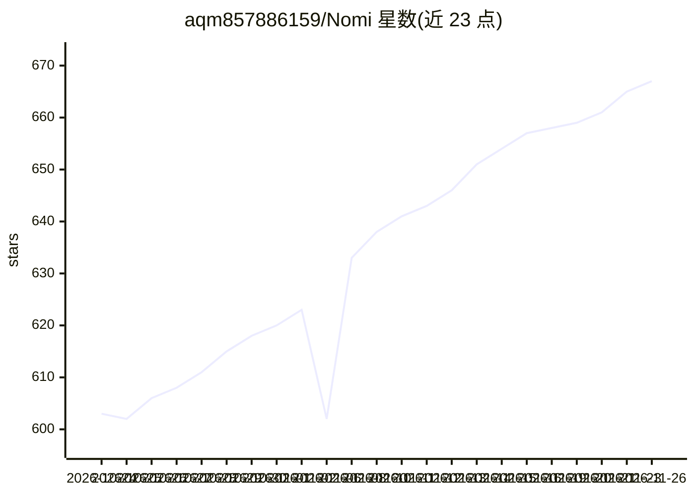

# aqm857886159/Nomi

⭐ 667 · TypeScript · AGPL-3.0 · 推送 2026-11-25 · [GitHub](https://github.com/aqm857886159/Nomi) · [官网](https://nomiaqm.com) · 个人维护 · 中文 README

**开源本地优先的 AI 视频工作室：Agent 分镜生成到可编辑时间线**

桌面端 AI 视频创作工具：内置 Agent 将一段故事拆解为分镜，逐镜生成关键帧与视频，并铺设到可编辑的时间线，最终导出 MP4。用户自行接入模型（中转服务、OpenAI 兼容端点或本地 ComfyUI），按供应商原价付费，无订阅与加价。内置 MCP 服务器（24 个工具）供 Claude Code/Codex/Cursor 驱动。项目与密钥留存在本机。提供 macOS/Windows 安装包，源码运行需 Node.js 20+ 与 pnpm。

## 筛选速览

| 维度 | 判定 | 备注 |
|---|---|---|
| AI 角色 | `ai-native` | 本体是模型或模型工具 |
| 许可风险 | `viral` | AGPL-3.0 |
| 部署形态 | `desktop` | 安装包/桌面程序 |
| 模型依赖 | — | README 未给出锁定关系 |
| 硬件要求 | — | 无带数字的原话,不猜 |
| 安装摩擦 | `low` | 无编译、无系统依赖或容器化 |
| 成熟度 | — | 结构信号不足 |

## 能力要点

- Agent 自动分镜、生成关键帧与视频并编排到可编辑时间线
- 内置 MCP 服务器（24 工具），可由 Claude Code/Codex/Cursor 驱动
- 自带模型：中转/OpenAI 兼容端点/本地 ComfyUI，按供应商原价付费
- 本地优先：项目为磁盘上的普通文件夹，无账号，遥测可关闭

## 适用场景

- 用自然语言让 Agent 生成完整分镜和视频初剪
- 锁定角色/场景参考卡保持多镜头人物一致性
- 通过 ComfyUI 用本地模型生成视频素材
- 用手机作取景器摆姿态与机位拍摄 3D 关键帧

## 场景标签

`图像生成` `视频生成` · 领域:内容生成

## 证据(README 行号)

> L28: - **What it is:** a desktop AI video studio. Its agent splits your story into shots, generates keyframes and video,
> L9:  Tell its agent what you want to make. It plans the shots, generates keyframes and video, and lays them on your time
> L131: Nomi ships an MCP server with 24 MCP tools, so Claude Code, Codex, or Cursor can drive it — generate, arrange, and

## 星数曲线

2026-10-24 603 → 2026-11-26 667（+64）

---
*卡片 v1 · prompt 1.4 · 生成 2026-11-24 · 置信度 high · 依据 README sha `6874a16c8a61` · [字段定义](../../DATASET.md)*
