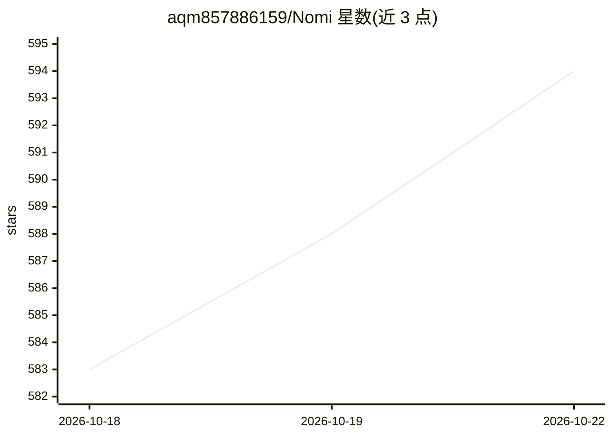

# aqm857886159/Nomi

⭐ 594 · TypeScript · AGPL-3.0 · 推送 2026-10-21 · [GitHub](https://github.com/aqm857886159/Nomi) · [官网](https://nomiaqm.com) · 个人维护 · 中文 README

**本地优先的开源 AI 视频工作台，自带 Agent 连接你自己的模型**

基于 Electron/React 的桌面 AI 视频工作室：内置 Agent 按需求拆分镜头、生成关键帧与视频并排布到时间线，支持逐镜头更换模型。模型通过 APIMart、Kie.ai、火山引擎、ModelScope、任意 OpenAI 兼容中继或本地 ComfyUI 接入，用户自付提供商价格，无账户、默认无遥测，项目以普通文件夹形式存于本地。附带 24 个工具的 MCP 服务器，可被 Claude Code/Codex/Cursor 驱动；还含 3D 导演（手机取景）与角色参考卡锁定。AGPL-3.0，提供 macOS/Windows 安装包，Linux 未发布。

## 筛选速览

| 维度 | 判定 | 备注 |
|---|---|---|
| AI 角色 | `ai-native` | 本体是模型或模型工具 |
| 许可风险 | `viral` | AGPL-3.0 |
| 部署形态 | `desktop` | 安装包/桌面程序 |
| 模型依赖 | — | README 未给出锁定关系 |
| 硬件要求 | — | 无带数字的原话,不猜 |
| 安装摩擦 | `low` | 无编译、无系统依赖或容器化 |
| 成熟度 | — | 结构信号不足 |

## 能力要点

- Agent 拆分镜头、生成关键帧与视频并自动排布时间线，支持逐步确认/自动/全自动三档
- 逐镜头更换模型：Seedance/Kling/Wan/Hailuo 等，可接中继或本地 ComfyUI
- 内置 24 个工具的 MCP 服务器，可由 Claude Code/Codex/Cursor 驱动
- 项目为本地普通文件夹，无账户，遥测为可选且可关闭

## 适用场景

- 用自己的 API key 和自选模型制作 AI 短片或分镜视频
- 让 Claude Code/Cursor 等 coding agent 通过 MCP 直接驱动视频工作台
- 通过 3D 摆位与手机取景控制画面构图，锁定角色参考卡保持一致性

## 场景标签

`视频生成` `图像生成` · 领域:内容生成

## 证据(README 行号)

> L8:  Tell its agent what you want to make. It plans the shots, generates keyframes and video, and lays them on your time
> L64: Seedance, Kling, Wan, Hailuo, Nano Banana, GPT Image and more — through APIMart, Kie.ai, Volcengine, ModelScope, a 
> L118: Nomi ships an MCP server with 24 MCP tools, so Claude Code, Codex, or Cursor can drive it — generate, arrange, and

## 星数曲线

2026-10-18 583 → 2026-10-22 594（+11）

---
*卡片 v1 · prompt 1.4 · 生成 2026-10-21 · 置信度 mid · 依据 README sha `c4556837351f` · [字段定义](../../DATASET.md)*
