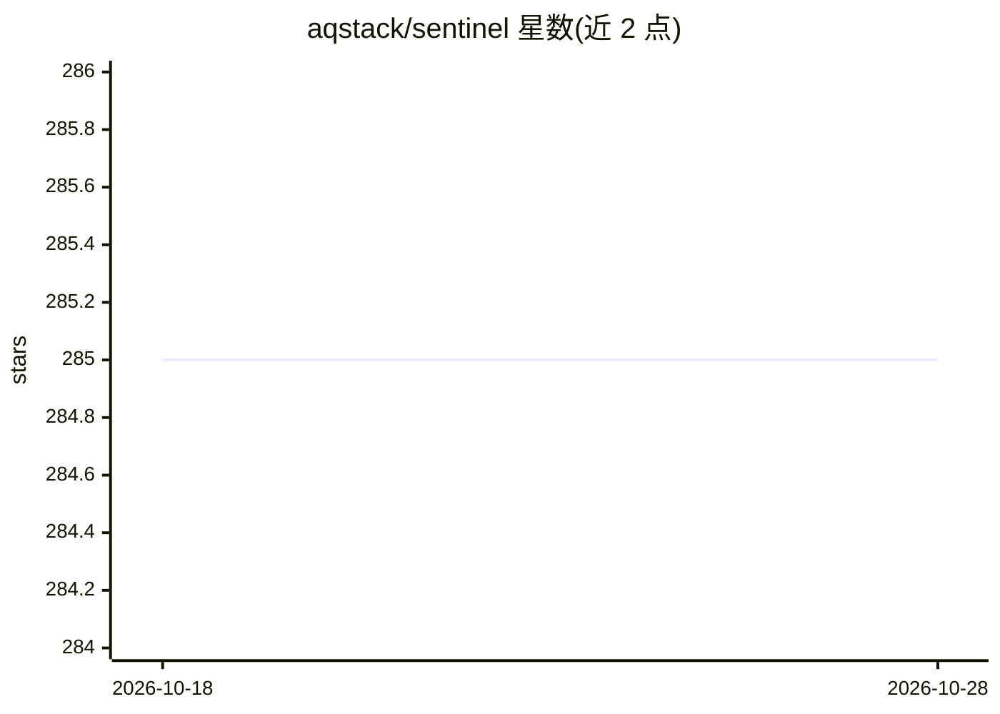

# aqstack/sentinel

⭐ 285 · Go · MIT · 推送 2026-01-04 · [GitHub](https://github.com/aqstack/sentinel) · 组织维护

**Kubernetes 边缘节点的故障预测与自治编排代理**

以 Go 编写的边缘计算代理，部署在每个 K8s 边缘节点上：监控 CPU 温度、内存压力、磁盘 I/O 与网络健康，用轻量统计模型预测故障；控制面失联时节点组成 Raft-lite 本地共识组继续自治运行，触发抢占式负载迁移与不健康节点隔离，恢复连接后对决策日志进行对账。模型运行占用 <64MB RAM，无需 GPU 或云端推理。通过 make 从源码构建，支持 ARM64 与容器镜像构建，提供 REST API 与 Prometheus 指标。

## 筛选速览

| 维度 | 判定 | 备注 |
|---|---|---|
| AI 角色 | `ai-native` | 本体是模型或模型工具 |
| 许可风险 | `permissive` | MIT |
| 部署形态 | `None` |  |
| 模型依赖 | — | README 未给出锁定关系 |
| 硬件要求 | — | 无带数字的原话,不猜 |
| 安装摩擦 | `low` | 无编译、无系统依赖或容器化 |
| 成熟度 | — | 结构信号不足 |

## 能力要点

- 基于 CPU 温度/内存压力/磁盘 I/O/网络的统计模型故障预测
- 控制面分区时 Raft-lite 本地共识自治运行
- 抢占式负载迁移与不健康节点隔离，恢复后决策对账
- 统计模型运行于 <64MB RAM，无 GPU 或云端推理依赖

## 适用场景

- 网络不稳定或恶劣环境下的 K8s 边缘节点运维
- 在故障发生前迁移工作负载、隔离劣化节点
- 通过 Prometheus 指标监控故障概率与分区状态

## 场景标签

 · 领域:边缘计算/云原生运维

## 证据(README 行号)

> L12: 1. **Predicts failures** - Monitors CPU thermals, memory pressure, disk I/O, and network health. Uses lightweight s
> L32: - **Lightweight, not bloated** - Runs statistical models in <64MB RAM, no GPUs or cloud inference needed

## 星数曲线

2026-10-18 285 → 2026-10-28 285（+0）

---
*卡片 v1 · prompt 1.4 · 生成 2026-10-22 · 置信度 mid · 依据 README sha `20f728c4dbf2` · [字段定义](../../DATASET.md)*
