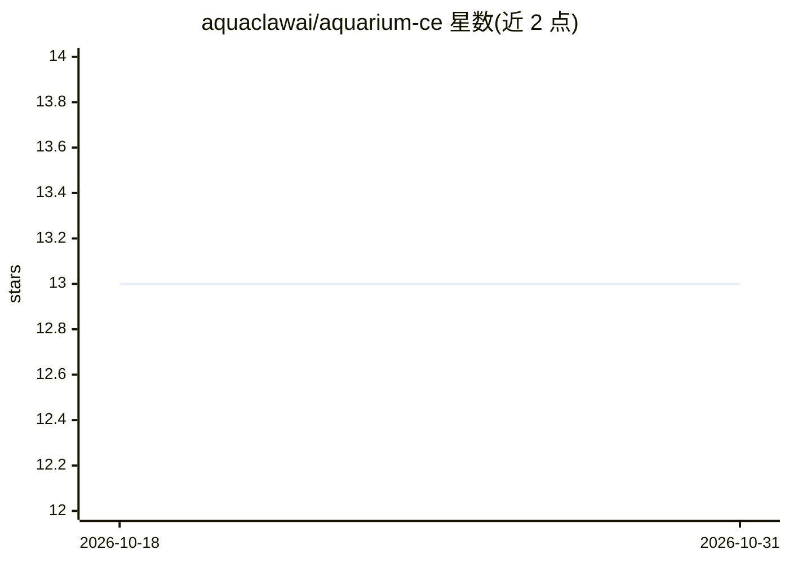

# aquaclawai/aquarium-ce

⭐ 13 · TypeScript · Apache-2.0 · 推送 2026-07-18 · [GitHub](https://github.com/aquaclawai/aquarium-ce) · 组织维护 · 中文 README

**自托管 AI Agent 管理平台：一条命令部署管理本地 Agent 实例**

基于 Node.js/TypeScript 的自托管 AI agent 管理平台，通过 npx 一条命令启动，在 http://localhost:3001 提供 Web 界面。功能包括：创建/启停/监控 agent 实例、内置流式聊天界面、通过统一接口接入 27+ AI 提供商、发布到 WhatsApp/Telegram/Discord/Slack 等 14 个消息渠道、MCP 工具扩展、API 密钥加密存储与健康监控。数据存于本地 SQLite，无遥测。要求 Node.js 22+，推荐 Docker。Apache 2.0 许可。

## 筛选速览

| 维度 | 判定 | 备注 |
|---|---|---|
| AI 角色 | `ai-ecosystem` | LLM/agent 周边工具 |
| 许可风险 | `permissive` | Apache-2.0 |
| 部署形态 | `library` | 以包/库形式分发 |
| 模型依赖 | — | README 未给出锁定关系 |
| 硬件要求 | — | 无带数字的原话,不猜 |
| 安装摩擦 | `low` | 无编译、无系统依赖或容器化 |
| 成熟度 | — | 结构信号不足 |

## 能力要点

- npx 单命令零配置启动，本地 SQLite 存储、无遥测
- 统一接口接入 27+ AI 提供商
- 14 个消息渠道（WhatsApp/Telegram/Discord/Slack 等）
- MCP 工具支持与 API 密钥加密存储

## 适用场景

- 在自己服务器上统一部署和管理多个 AI agent 实例
- 将 agent 接入 WhatsApp/Telegram 等聊天渠道对外提供服务
- 不依赖云平台、本地掌控数据地运行 AI agent

## 场景标签

`Agent 框架` `模型网关` · 领域:Agent 开发

## 证据(README 行号)

> L5: Deploy, orchestrate, and manage AI agent instances with a single command.
> L31: - **Any provider, any model** — Connect 27+ AI providers through a unified interface

## 星数曲线

2026-10-18 13 → 2026-10-31 13（+0）

---
*卡片 v1 · prompt 1.4 · 生成 2026-10-31 · 置信度 high · 依据 README sha `18abfd350a71` · [字段定义](../../DATASET.md)*
