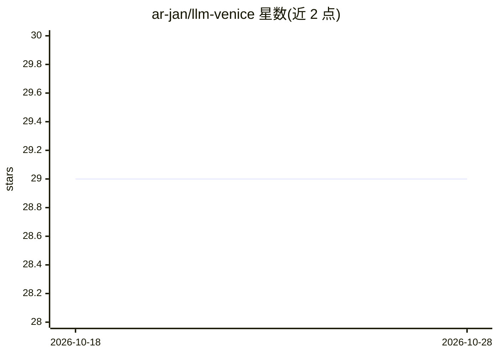

# ar-jan/llm-venice

⭐ 29 · Python · Apache-2.0 · 推送 2026-10-28 · [GitHub](https://github.com/ar-jan/llm-venice) · 个人维护

**接入 Venice AI API 的 LLM 命令行插件：文本/图像/TTS 生成**

面向 LLM（llm CLI）用户的插件，通过 Venice AI API 调用其模型：文本对话（含结构化输出、函数调用、视觉模型）、文生图（含变体、分辨率预设）、文生语音与图像放大，并提供网页搜索/抓取、公共角色等 venice_parameters 选项。模型列表缓存于 venice_models.json，需 API key 并在模型变更时手动 refresh。以 pip/llm install 安装，另提供 Python 库级辅助函数与异步模型接口（程序化用途标注为 minimally tested）。

## 筛选速览

| 维度 | 判定 | 备注 |
|---|---|---|
| AI 角色 | `ai-ecosystem` | LLM/agent 周边工具 |
| 许可风险 | `permissive` | Apache-2.0 |
| 部署形态 | `library` | 以包/库形式分发 |
| 模型依赖 | — | README 未给出锁定关系 |
| 硬件要求 | — | 无带数字的原话,不猜 |
| 安装摩擦 | `low` | 无编译、无系统依赖或容器化 |
| 成熟度 | — | 结构信号不足 |

## 能力要点

- 通过 llm CLI 调用 Venice API 的文本、图像、TTS 模型
- 支持结构化输出（JSON schema）与函数调用
- 图像放大命令与图像生成变体/分辨率选项
- 提供 Python 辅助函数与异步模型注册

## 适用场景

- 在命令行中直接使用 Venice AI 的文本与图像模型
- 通过 llm 插件生态统一管理 Venice API key 与模型
- 脚本化调用 Venice 的 TTS 与图像放大功能

## 场景标签

`图像生成` `语音合成` · 领域:内容生成

## 证据(README 行号)

> L8: LLM plugin to access models available via the Venice AI API.
> L12: Install `llm-venice` with its dependency `llm` using your package manager of choice, for example:

## 星数曲线

2026-10-18 29 → 2026-10-28 29（+0）

---
*卡片 v1 · prompt 1.4 · 生成 2026-10-26 · 置信度 high · 依据 README sha `6c8fe9af487c` · [字段定义](../../DATASET.md)*
