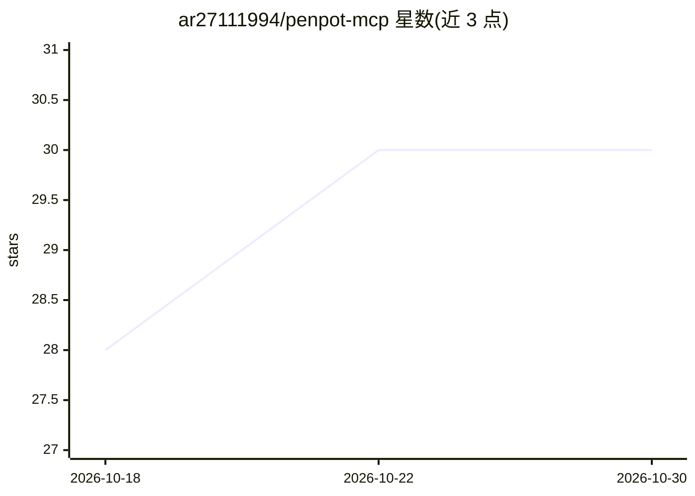

# ar27111994/penpot-mcp

⭐ 30 · JavaScript · MIT · 推送 2026-10-25 · [GitHub](https://github.com/ar27111994/penpot-mcp) · [官网](https://www.skills.sh/ar27111994/penpot-mcp) · 个人维护

**让 AI agent 通过 Penpot MCP 创建与维护设计系统的技能包**

面向 MCP 兼容 agent（Claude Code、Cursor、VS Code/Copilot、Codex 等）的 Penpot 技能：核心 SKILL.md 常驻上下文，references 目录按任务加载。内容覆盖远程与本地 MCP 配置、全部 5 个 MCP 工具、Penpot JS API 模式与字体约束、写安全规则（约 10 操作/批、页面切换两次调用）、交互与动画完整 API、原型工作流、三级 token 层级、设计系统构建与审计、设计转代码（HTML/CSS、React、Style Dictionary）。基于官方 Penpot MCP 文档与插件 API 文档编写。

## 筛选速览

| 维度 | 判定 | 备注 |
|---|---|---|
| AI 角色 | `ai-knowledge` | 知识聚合/清单类 |
| 许可风险 | `permissive` | MIT |
| 部署形态 | `library` | 以包/库形式分发 |
| 模型依赖 | — | README 未给出锁定关系 |
| 硬件要求 | — | 无带数字的原话,不猜 |
| 安装摩擦 | `low` | 无编译、无系统依赖或容器化 |
| 成熟度 | — | 结构信号不足 |

## 能力要点

- 覆盖全部 5 个 Penpot MCP 工具与远程/本地 MCP 配置
- 完整交互与动画 API（全部触发器/动作/动画与缓动）
- 写安全规则：批操作上限、页面切换两次调用模式
- 设计系统构建/审计与设计转代码工作流（含 Style Dictionary）

## 适用场景

- 让 Claude Code/Cursor 等 agent 按安全规则操作 Penpot 设计文件
- 从零构建或审计设计系统与 token 层级
- 把 Penpot 页面转为 HTML/CSS 或 React 代码

## 场景标签

`代码生成` · 领域:编码与开发

## 证据(README 行号)

> L10: > AI-agent skill for creating, auditing, and maintaining production-grade design projects and design systems — incl
> L51: ├── SKILL.md                                ← Always-loaded core

## 星数曲线

2026-10-18 28 → 2026-10-30 30（+2）

---
*卡片 v1 · prompt 1.4 · 生成 2026-10-26 · 置信度 high · 依据 README sha `06812e63ce88` · [字段定义](../../DATASET.md)*
