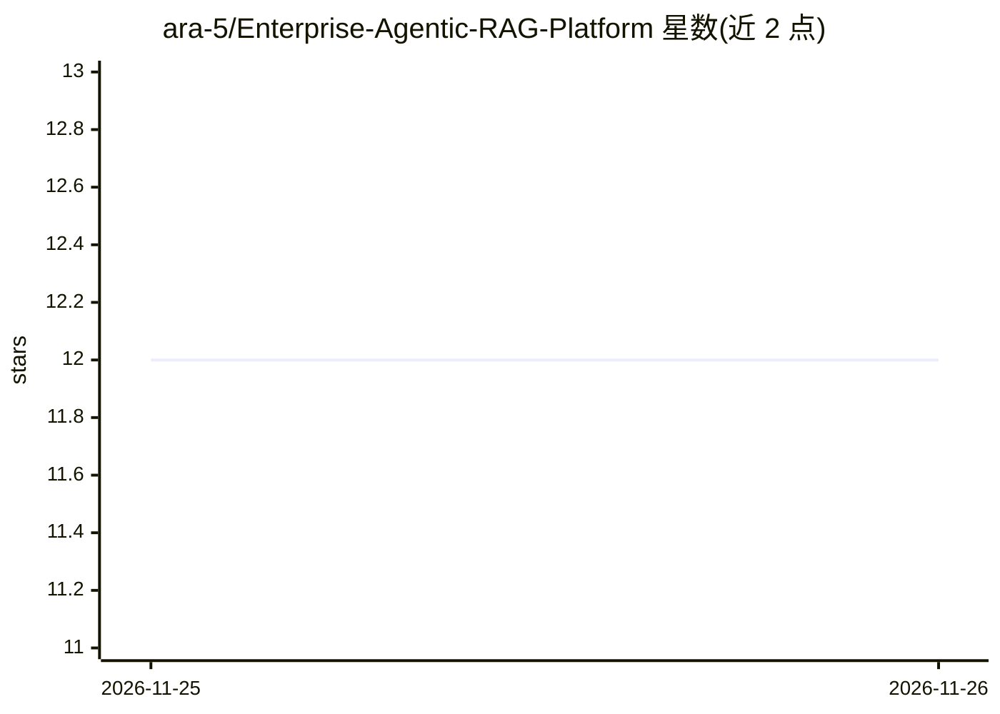

# ara-5/Enterprise-Agentic-RAG-Platform

⭐ 12 · Python · 推送 2026-10-05 · [GitHub](https://github.com/ara-5/Enterprise-Agentic-RAG-Platform) · 个人维护

**面向开发者的 Agentic RAG 系统，带纠错检索与评测门**

基于 LangGraph 的 Agentic RAG 系统：BM25+FAISS 混合检索经 RRF 融合，交叉编码器将候选从 top-20 重排到 top-5；文档相关性评分不佳时自动改写查询重试（至多 2 次），仍失败则回退 Tavily 网络搜索。维护多轮对话记忆，提供 RAGAs 指标评测（faithfulness/relevancy/precision/recall）与 CI 质量门。LLM 经 Ollama 本地运行 llama3.2，需配置 Tavily API key。后端 FastAPI，前端 Streamlit 聊天界面，支持 docker-compose 部署。作者署名为个人（AI Engineer），README 含个人作品集性质的评测结果展示。

## 筛选速览

| 维度 | 判定 | 备注 |
|---|---|---|
| AI 角色 | `ai-native` | 本体是模型或模型工具 |
| 许可风险 | `none` | — |
| 部署形态 | `self-host` | docker 或自建部署 |
| 模型依赖 | local-ok | 支持本地模型 |
| 硬件要求 | — | 无带数字的原话,不猜 |
| 安装摩擦 | `low` | 无编译、无系统依赖或容器化 |
| 成熟度 | — | 结构信号不足 |

## 能力要点

- 混合检索：FAISS 密集 + BM25 稀疏，经 RRF 融合
- Corrective RAG：相关性差时改写查询重试，失败后 Tavily 网络搜索回退
- RAGAs 评测随 CI 运行，faithfulness 低于 0.70 时流水线失败
- 本地 Ollama (llama3.2) 推理，FastAPI 提供 /ingest /query /metrics 接口

## 适用场景

- 在本地 LLM 环境下对自有 PDF 文档构建带引用来源的问答系统
- 为 RAG 系统建立 CI 中的 RAGAs 质量门
- 需要查询改写与网络搜索回退的 agentic 检索流程

## 场景标签

`RAG` `模型评测` · 领域:评测与运维

## 证据(README 行号)

> L3: > **Production-grade Retrieval-Augmented Generation system** with a LangGraph agentic loop, hybrid BM25+FAISS retrie
> L47: |LLM|Ollama (llama3.2)|Local, privacy-preserving inference|
> L51: |Evaluation|RAGAs|Faithfulness, relevancy, precision, recall metrics|

## 星数曲线

2026-11-25 12 → 2026-11-26 12（+0）

---
*卡片 v1 · prompt 1.4 · 生成 2026-11-25 · 置信度 high · 依据 README sha `ca7a4a534264` · [字段定义](../../DATASET.md)*
