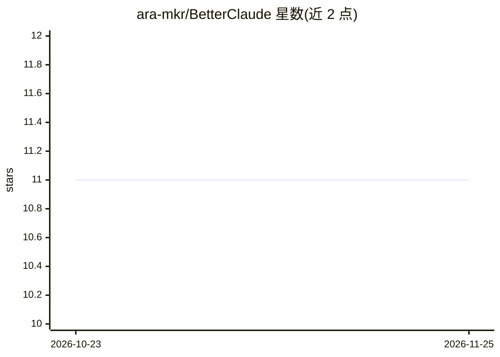

# ara-mkr/BetterClaude

⭐ 11 · CSS · MIT · 推送 2026-10-04 · [GitHub](https://github.com/ara-mkr/BetterClaude) · 个人维护

**给 Claude 桌面用户的增强套件：主题、插件与 Code 工作台**

一个 Electron 桌面应用，加载真实的 claude.ai 页面并在其上叠加本地 UI 层：130 个主题、20 个 dock 小部件、命令面板、提示词库、技能市场，以及承载真实 Claude Code 会话的 Code/CLI 标签页和内置 VSCodium 工作台。非 fork、非代理，不修改 Anthropic 代码、不接管登录，全部功能默认关闭、数据本地存储。Code/CLI 标签需本机安装并登录 Claude Code CLI；macOS 听写功能需 whisper-cpp。提供 macOS/Windows 安装包与一条命令安装脚本。

## 筛选速览

| 维度 | 判定 | 备注 |
|---|---|---|
| AI 角色 | `ai-ecosystem` | LLM/agent 周边工具 |
| 许可风险 | `permissive` | MIT |
| 部署形态 | `desktop` | 安装包/桌面程序 |
| 模型依赖 | local-ok | 支持本地模型 |
| 硬件要求 | — | 无带数字的原话,不猜 |
| 安装摩擦 | `low` | 无编译、无系统依赖或容器化 |
| 成熟度 | — | 结构信号不足 |

## 能力要点

- 130 个主题、20 个小部件、命令面板与提示词库等本地 UI 增强
- Code 标签页承载真实 Claude Code 会话（并行会话、内联审批、权限模式）
- 内置 VSCodium 工作台与嵌入式终端，支持经 gh 的 Commit & PR
- 免费模型故障转移经 OpenRouter 或本地 Ollama

## 适用场景

- 在不改动 claude.ai 登录与账号的前提下美化与定制界面
- 用 IDE 式布局管理多个 Claude Code 项目与会话
- 团队共享插件、主题与会话记录（Team Hub / Team Sync）
- 用本地 Ollama 或 OpenRouter 免费模型做故障转移

## 场景标签

`提示工程` · 领域:Agent 开发

## 证据(README 行号)

> L27: **BetterClaude** is a BetterDiscord-style enhancement suite for Claude: a desktop app that loads the **real claude.
> L127: Architecture: the renderer holds claude.ai, the BetterClaude core bundle, and the Code, CLI and Full IDE surfaces.
> L143: The Code tab is laid out like Claude Code's desktop app, and its conversation is a **real Claude Code session on y

## 星数曲线

2026-10-23 11 → 2026-11-25 11（+0）

---
*卡片 v1 · prompt 1.4 · 生成 2026-11-18 · 置信度 mid · 依据 README sha `f592cd61d87b` · [字段定义](../../DATASET.md)*
