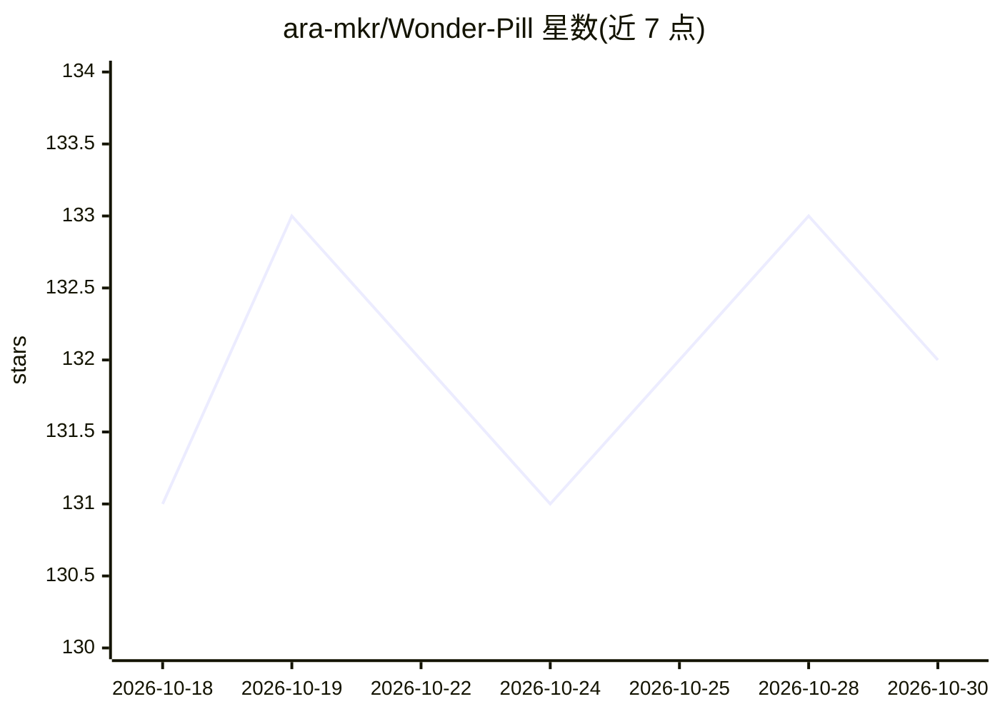

# ara-mkr/Wonder-Pill

⭐ 132 · MIT · 推送 2026-09-02 · [GitHub](https://github.com/ara-mkr/Wonder-Pill) · 个人维护

**Claude 头脑风暴技能：把假设反转成交互式思维导图，不给答案**

以 SKILL.md 形式安装在 Claude（Claude Code / Desktop）中的头脑风暴技能：通过三个前置问题校准发散尺度后，先寻找反常识事实作种子，再从 3–5 个承重假设逐条反演生成 what-if，经七类变换延伸分支，保留被废弃节点与跨分支连线，输出可拖拽的交互式思维导图、定位段落与书面 wondering 三部分；不排序、不收敛、不给推荐。作者声明约三分之一产出无用属设计预期，且无现实检验环节、不知道领域内已有尝试。

## 筛选速览

| 维度 | 判定 | 备注 |
|---|---|---|
| AI 角色 | `ai-native` | 本体是模型或模型工具 |
| 许可风险 | `permissive` | MIT |
| 部署形态 | `None` |  |
| 模型依赖 | locked-api |  |
| 硬件要求 | — | 无带数字的原话,不猜 |
| 安装摩擦 | `low` | 无编译、无系统依赖或容器化 |
| 成熟度 | — | 结构信号不足 |

## 能力要点

- what-if 一律由命名假设反演推导，不自由发明
- 输出交互式思维导图，含种子节点、死胡同（带三字段废弃理由）与交叉连线
- 三分部交付：导图 + throughlines 定位段 + Premise→What if→tendrils→gut-check 文本
- 刻意不排序不收敛，需要推荐时须显式要求

## 适用场景

- 项目立项前探索非常规角度，避开模型常见的保守答案
- 想开放地想清楚一个问题而不是马上要结论
- 对已选定分支再做一轮假设反演深挖

## 场景标签

 · 领域:创意工具/Agent 技能

## 证据(README 行号)

> L3:  A Claude skill that refuses to give you the answer.
> L95: Download `wonder-pill.skill` from Releases and click **Save skill** on the file card in Claude.

## 星数曲线

2026-10-18 131 → 2026-10-30 132（+1）

---
*卡片 v1 · prompt 1.4 · 生成 2026-10-22 · 置信度 high · 依据 README sha `15e597b9c062` · [字段定义](../../DATASET.md)*
