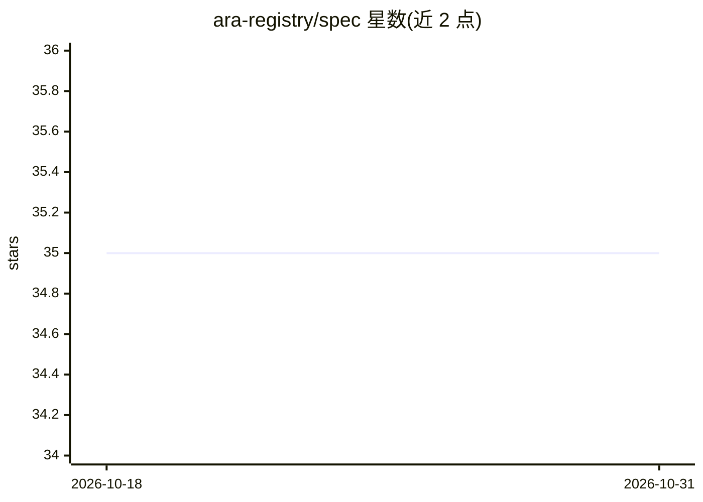

# ara-registry/spec

⭐ 35 · Rust · Apache-2.0 · 推送 2026-04-08 · [GitHub](https://github.com/ara-registry/spec) · 组织维护

**AI 开发工件的包注册表规范：agents、MCP 服务器、skills 等**

面向 AI 编码工具的厂商中立开放标准，定义包注册表与分发系统，覆盖 agent、mcp-server、powers、steering、skill、context、agents-md 七类包类型；提供 ara.json 清单格式、JSON Schema、Registry HTTP API 规范与实现方安全指引。任何 AI 编码工具（Kiro、Claude Code、Cursor、VS Code Copilot、Windsurf 等）可实现该标准，可用 platform 字段声明工具专属安装目标。仓库本身为规范文档，Apache-2.0 许可。

## 筛选速览

| 维度 | 判定 | 备注 |
|---|---|---|
| AI 角色 | `ai-ecosystem` | LLM/agent 周边工具 |
| 许可风险 | `permissive` | Apache-2.0 |
| 部署形态 | `None` |  |
| 模型依赖 | — | README 未给出锁定关系 |
| 硬件要求 | — | 无带数字的原话,不猜 |
| 安装摩擦 | `low` | 无编译、无系统依赖或容器化 |
| 成熟度 | — | 结构信号不足 |

## 能力要点

- 定义 7 类 AI 开发包类型（agent/mcp-server/powers/steering/skill/context/agents-md）
- 提供 ara.json 清单格式、JSON Schema 与 Registry HTTP API 规范
- 厂商中立：Kiro、Claude Code、Cursor、VS Code Copilot、Windsurf 等均可实现

## 适用场景

- AI 编码工具实现标准化的技能与 agent 分发通道
- 注册表实现方按规范构建包管理服务
- 包作者用 ara.json 声明清单与工具专属安装目标

## 场景标签

 · 领域:AI 工具链/包管理标准

## 证据(README 行号)

> L3: ARA (pronounced: _ah-rah_) is a package registry and distribution system for AI development artifacts. It provides a
> L5: ARA is a vendor-agnostic open standard — any AI coding tool can implement it, including Kiro, Claude Code, Cursor, V

## 星数曲线

2026-10-18 35 → 2026-10-31 35（+0）

---
*卡片 v1 · prompt 1.4 · 生成 2026-10-25 · 置信度 high · 依据 README sha `d70ceff1d610` · [字段定义](../../DATASET.md)*
