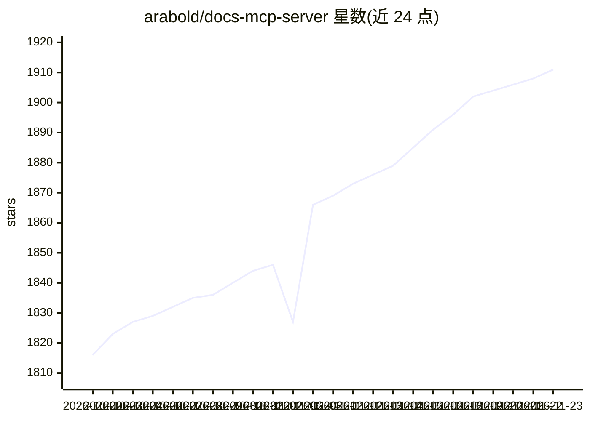

# arabold/docs-mcp-server

⭐ 1,911 · TypeScript · MIT · 推送 2026-11-22 · [GitHub](https://github.com/arabold/docs-mcp-server) · [官网](https://grounded.tools) · 个人维护

**给 AI 编码助手提供按版本索引的文档检索 MCP 服务器**

MCP 服务器，从网站、GitHub 仓库、npm、PyPI 包和本地文件夹抓取文档并建立按库版本分开的索引，通过 MCP 协议、命令行和 Web UI 提供检索；检索结合全文匹配与可选向量搜索，向量嵌入可由多种服务商或本地模型计算。运行需要 Node.js 22.14+ 或 Docker，索引存储在本地 SQLite 数据库。README 自述为 Context7、Nia 和 Ref.Tools 的开源替代品。默认开启使用遥测，可关闭。

## 筛选速览

| 维度 | 判定 | 备注 |
|---|---|---|
| AI 角色 | `ai-ecosystem` | LLM/agent 周边工具 |
| 许可风险 | `permissive` | MIT |
| 部署形态 | `self-host` | docker 或自建部署 |
| 模型依赖 | local-ok | 支持本地模型 |
| 硬件要求 | — | 无带数字的原话,不猜 |
| 安装摩擦 | `low` | 无编译、无系统依赖或容器化 |
| 成熟度 | — | 结构信号不足 |

## 能力要点

- 索引网站、GitHub 仓库、npm/PyPI 包、本地文件夹和 ZIP/TAR 归档
- 按库版本分开存储索引，检索指向项目所用版本
- 全文检索结合可选向量搜索，支持多种嵌入服务商或本地模型
- 支持 stdio 或 Streamable HTTP 连接任意 MCP 客户端，另提供 CLI 与 Web UI

## 适用场景

- 让 AI 编码助手基于项目所用版本的官方文档回答，而非依赖记忆
- 在脚本或编码 agent 中用 CLI 直接索引和检索文档
- 团队自托管文档检索服务并接入自用 MCP 客户端

## 场景标签

`RAG` `文档问答` `语义搜索` · 领域:知识与检索

## 证据(README 行号)

> L3: Grounded Docs gives your AI coding assistant a documentation index that matches the library versions you use. It fet
> L5: It is an open-source alternative to Context7, Nia and Ref.Tools.
> L16: - Works with any MCP client, over stdio or Streamable HTTP.

## 星数曲线

2026-10-20 1,816 → 2026-11-23 1,911（+95）

---
*卡片 v1 · prompt 1.4 · 生成 2026-11-23 · 置信度 mid · 依据 README sha `3e426f70f84f` · [字段定义](../../DATASET.md)*
