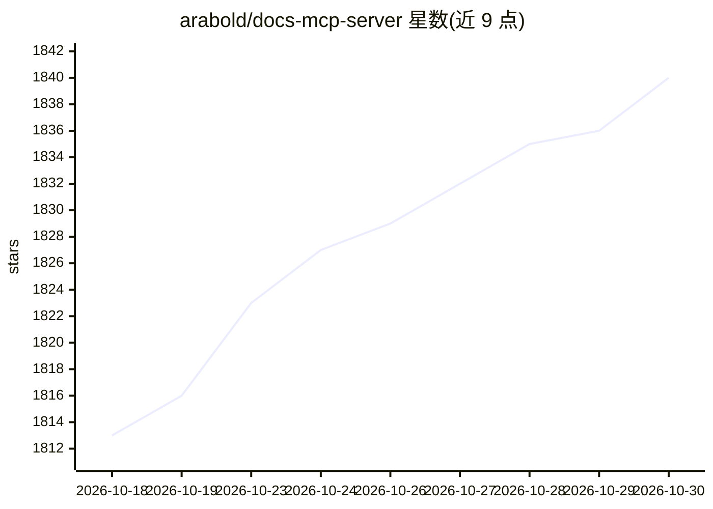

# arabold/docs-mcp-server

⭐ 1,840 · TypeScript · MIT · 推送 2026-10-25 · [GitHub](https://github.com/arabold/docs-mcp-server) · [官网](https://grounded.tools) · 个人维护

**给 AI 编程助手提供版本匹配文档索引的 MCP 服务器**

从网站、GitHub 仓库、npm、PyPI 包和本地文件夹抓取文档，按库版本分别存储，通过 MCP（stdio 或 Streamable HTTP）、命令行和 Web UI 提供搜索服务，供 Claude Code、Claude Desktop、Zed 等 MCP 客户端的 AI 编程助手使用。全文检索默认可用，可选接入 OpenAI、Ollama、Gemini、Vertex AI、AWS Bedrock、Azure OpenAI 等做向量检索；索保存于本地 SQLite，配置本地嵌入模型时文档文本不出本机。需 Node.js 22+ 或 Docker，默认开启使用遥测，可关闭。

## 筛选速览

| 维度 | 判定 | 备注 |
|---|---|---|
| AI 角色 | `ai-ecosystem` | LLM/agent 周边工具 |
| 许可风险 | `permissive` | MIT |
| 部署形态 | `self-host` | docker 或自建部署 |
| 模型依赖 | local-ok | 支持本地模型 |
| 硬件要求 | — | 无带数字的原话,不猜 |
| 安装摩擦 | `low` | 无编译、无系统依赖或容器化 |
| 成熟度 | — | 结构信号不足 |

## 能力要点

- 按库版本分别存储索引，搜索可针对项目所用版本
- 索引来源覆盖网站、GitHub、npm、PyPI、本地文件夹与压缩包
- 全文检索 + 可选向量检索（OpenAI/Ollama/Gemini/Bedrock/Azure 等多种嵌入提供方）
- 支持 stdio 与 Streamable HTTP，兼容任意 MCP 客户端

## 适用场景

- 让 Cursor/Windsurf/Claude Code 等 AI 编程助手基于当前版本的官方文档回答
- 为本地或私有文档构建可被编码 agent 检索的索引
- 通过 CLI 在脚本中对文档做索引与检索

## 场景标签

`语义搜索` `网页抓取` · 领域:效率与自动化

## 证据(README 行号)

> L3: Grounded Docs gives your AI coding assistant a documentation index that matches the library versions you use. It fet
> L16: - Works with any MCP client, over stdio or Streamable HTTP.
> L65: Connecting MCP Clients has the exact settings for Claude Code, Claude Desktop, Zed and other clients, how a client 

## 星数曲线

2026-10-18 1,813 → 2026-10-30 1,840（+27）

---
*卡片 v1 · prompt 1.4 · 生成 2026-10-21 · 置信度 mid · 依据 README sha `8aa207d1d7c9` · [字段定义](../../DATASET.md)*
