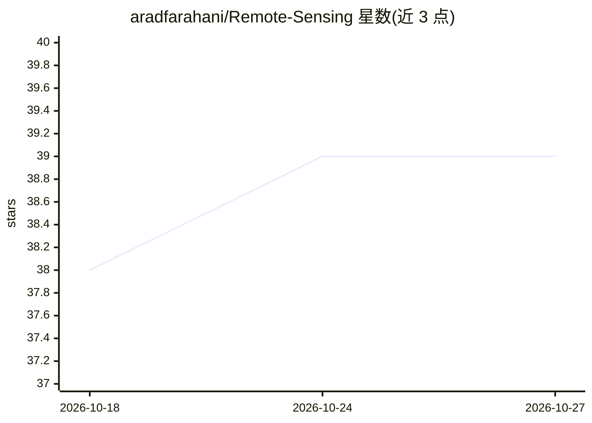

# aradfarahani/Remote-Sensing

⭐ 39 · Jupyter Notebook · MIT · 推送 2026-10-16 · [GitHub](https://github.com/aradfarahani/Remote-Sensing) · [官网](https://FEZtool.com) · 个人维护

**遥感影像处理与机器学习示例代码合集（15 个主题）**

个人维护的 Python 遥感学习项目，受 ENVI 启发，按主题文件夹组织：卫星影像导入与可视化、图像增强、shapefile 掩膜、正射镶嵌、HSV 分析、光谱剖面、PCA、光谱指数、k-means 聚类、空间滤波、变化检测（CVA）、GLCM 纹理、SVM 分类、时间序列与 Sentinel-2 岩性分类的 CNN。使用 scikit-image、scikit-learn 处理 Landsat-8 等影像。README 未给出安装命令，需自行配置 Python 环境运行各脚本。

## 筛选速览

| 维度 | 判定 | 备注 |
|---|---|---|
| AI 角色 | `ai-knowledge` | 知识聚合/清单类 |
| 许可风险 | `permissive` | MIT |
| 部署形态 | `None` |  |
| 模型依赖 | — | README 未给出锁定关系 |
| 硬件要求 | — | 无带数字的原话,不猜 |
| 安装摩擦 | `low` | 无编译、无系统依赖或容器化 |
| 成熟度 | — | 结构信号不足 |

## 能力要点

- 15 个遥感主题文件夹，含示例图像与结果
- 覆盖传统处理（镶嵌/掩膜/指数）与机器学习（SVM/PCA/k-means）
- CNN 用于 Sentinel-2 岩性分类，附 ROC 曲线与混淆矩阵验证

## 适用场景

- 学习用 Python 处理 Landsat-8 等卫星影像的流程
- 参考变化检测与光谱指数计算的示例代码
- 了解 CNN 在地质岩性分类中的应用方式

## 场景标签

`教程课程` `图像视频处理` · 领域:学习与行业

## 证据(README 行号)

> L4: "Remote Sensing" is a Python-based project inspired by ENVI (developed by L3Harris Geospatial) but designed to push 
> L6: This project is organized into topical folders, each focusing on a specific aspect of remote sensing. Let’s dive int

## 星数曲线

2026-10-18 38 → 2026-10-27 39（+1）

---
*卡片 v1 · prompt 1.4 · 生成 2026-10-25 · 置信度 mid · 依据 README sha `b2d605eb3417` · [字段定义](../../DATASET.md)*
