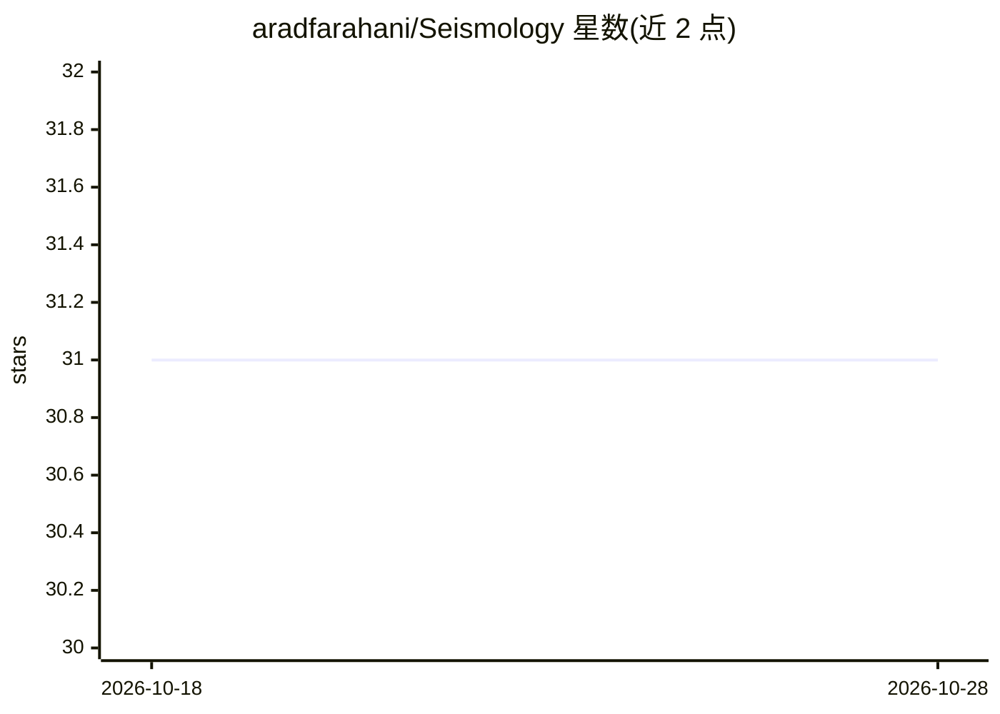

# aradfarahani/Seismology

⭐ 31 · Jupyter Notebook · MIT · 推送 2026-10-27 · [GitHub](https://github.com/aradfarahani/Seismology) · 个人维护

**面向地震学的机器学习工具集合：地震数据预处理、检测与可视化**

定位为机器学习与地震学交叉的研究工具仓库，计划提供地震数据集清洗与预处理、地震事件检测与分类的 ML 模型、交互式可视化及标准化评测基准；数据源使用 ObsPy 示例波形与 USGS 地震记录（近一个月 2.5 级以上）。给地震学与地球物理研究人员使用。需注意：README 多处标注功能尚未发布（"Coming Soon"、依赖文件与使用说明待补充），当前仓库主要为项目结构与示例数据，核心功能仍在开发中。

## 筛选速览

| 维度 | 判定 | 备注 |
|---|---|---|
| AI 角色 | `ai-native` | 本体是模型或模型工具 |
| 许可风险 | `permissive` | MIT |
| 部署形态 | `library` | 以包/库形式分发 |
| 模型依赖 | — | README 未给出锁定关系 |
| 硬件要求 | — | 无带数字的原话,不猜 |
| 安装摩擦 | `low` | 无编译、无系统依赖或容器化 |
| 成熟度 | `idea` | |

## 能力要点

- 地震数据预处理工具（清洗、格式化、准备数据集）
- 地震事件检测与分类的机器学习模型实现
- 交互式可视化展示地震数据与模型预测
- 使用 ObsPy 波形与 USGS 地震记录作为数据源

## 适用场景

- 处理与准备地震波形数据用于研究分析
- 用机器学习模型检测和分类地震事件
- 可视化地震数据与模型预测结果

## 场景标签

 · 领域:地球物理/地震学

## 证据(README 行号)

> L9: Welcome to the **Seismology** repository! This project explores the intersection of machine learning and seismology,
> L24: - **Machine Learning Models**: State-of-the-art ML implementations for detecting and classifying seismic events.

## 星数曲线

2026-10-18 31 → 2026-10-28 31（+0）

---
*卡片 v1 · prompt 1.4 · 生成 2026-10-26 · 置信度 low · 依据 README sha `4d0c8a63ec40` · [字段定义](../../DATASET.md)*
