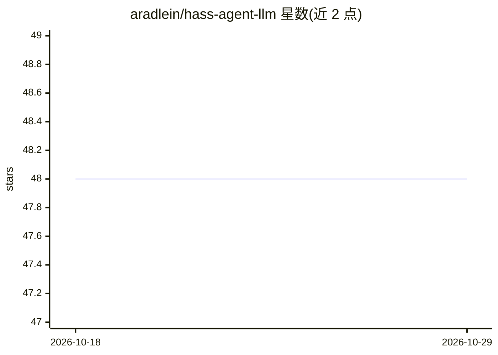

# aradlein/hass-agent-llm

⭐ 48 · Python · MIT · 推送 2026-05-11 · [GitHub](https://github.com/aradlein/hass-agent-llm) · 个人维护

**Home Assistant 对话 AI 组件：接入 OpenAI 兼容 LLM 控制智能家居**

Home Assistant 自定义组件，扩展原生对话平台：通过任意 OpenAI 兼容端点（OpenAI/Azure/Ollama/LocalAI 等）实现自然语言家居控制与查询。机制包括自动实体状态上下文注入、基于 ChromaDB 的语义实体检索、自动记忆抽取与召回、持久化多轮对话（按用户/设备独立会话）、流式响应支持语音助手，以及内置 ha_control/ha_query 工具与自定义 REST/服务工具。面向 Home Assistant 用户，经 HACS 或手动复制安装，要求 HA 2026.3.1+（Python 3.14）。

## 筛选速览

| 维度 | 判定 | 备注 |
|---|---|---|
| AI 角色 | `ai-native` | 本体是模型或模型工具 |
| 许可风险 | `permissive` | MIT |
| 部署形态 | `None` |  |
| 模型依赖 | local-ok | 支持本地模型 |
| 硬件要求 | — | 无带数字的原话,不猜 |
| 安装摩擦 | `low` | 无编译、无系统依赖或容器化 |
| 成熟度 | — | 结构信号不足 |

## 能力要点

- 兼容任意 OpenAI 兼容端点，支持本地 Ollama/LocalAI/LM Studio
- ChromaDB 向量实体检索与自动记忆抽取召回
- 内置 ha_control/ha_query 工具，可配置 REST 与 HA 服务自定义工具
- 按用户/设备的持久多轮对话与低延迟流式响应

## 适用场景

- 用自然语言或语音控制灯光、温控等智能家居设备
- 让家居助手记住偏好并跨对话保持上下文
- 为 Home Assistant 接入本地或云端 LLM 作为对话代理

## 场景标签

`聊天机器人` `语音 Agent` · 领域:对话与助手

## 证据(README 行号)

> L9: A highly customizable Home Assistant custom component that provides intelligent conversational AI capabilities with 
> L26: Home Agent extends Home Assistant's native conversation platform to enable natural language control and monitoring 
> L40: - **LLM Integration** - Works with OpenAI, Azure OpenAI, Ollama, LocalAI, LM Studio, or any OpenAI-compatible endpo

## 星数曲线

2026-10-18 48 → 2026-10-29 48（+0）

---
*卡片 v1 · prompt 1.4 · 生成 2026-10-25 · 置信度 high · 依据 README sha `c4975823a4b4` · [字段定义](../../DATASET.md)*
