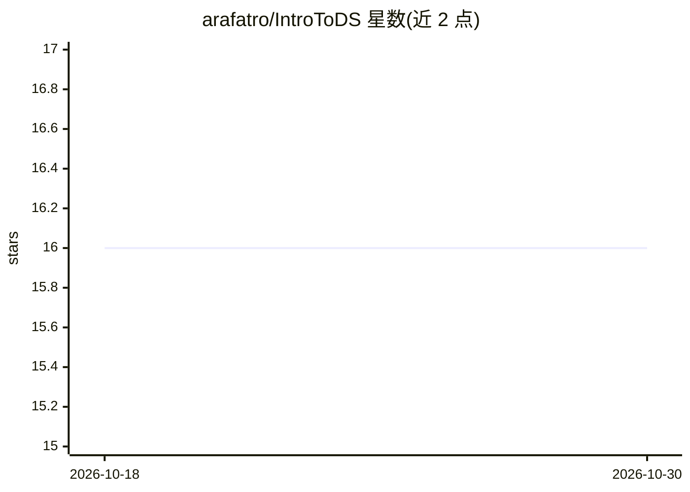

# arafatro/IntroToDS

⭐ 16 · Jupyter Notebook · 推送 2026-10-22 · [GitHub](https://github.com/arafatro/IntroToDS) · 个人维护

**数据科学导论课程资源：Python 环境到建模全流程大纲**

Eötvös Loránd 大学（ELTE）讲师 Arafat Md Easin 维护的数据科学实践课程资源仓库：以课程大纲与讲义为主，覆盖 Python 环境与 IDE 介绍、EDA、数据预处理与降维、特征工程、监督/无监督建模（分类、回归、聚类、关联规则）、模型评估与交叉验证，直至 Kaggle 竞赛和学期项目；列出 NumPy、pandas、sklearn、matplotlib 等教学用包，并附数据集网站清单。内容面向选课学生的课程实践，不提供软件安装运行。

## 筛选速览

| 维度 | 判定 | 备注 |
|---|---|---|
| AI 角色 | `ai-knowledge` | 知识聚合/清单类 |
| 许可风险 | `none` | — |
| 部署形态 | `None` |  |
| 模型依赖 | — | README 未给出锁定关系 |
| 硬件要求 | — | 无带数字的原话,不猜 |
| 安装摩擦 | `low` | 无编译、无系统依赖或容器化 |
| 成熟度 | — | 结构信号不足 |

## 能力要点

- 覆盖 EDA 到模型评估的完整课程大纲
- 列出 NumPy/pandas/sklearn 等 7 个教学用 Python 包
- 含 Kaggle 竞赛与学期项目安排
- 附 CMU/Kaggle/UCI 等数据集网站清单

## 适用场景

- 数据科学入门学习者按大纲系统自学
- 查找课程配套的数据集来源
- 了解监督/无监督建模与评估的实践流程

## 场景标签

`教程课程` · 领域:学习与行业

## 证据(README 行号)

> L20: # Introduction to Data Science Practice Course Outline
> L60: ## Model Development with Supervised Learning

## 星数曲线

2026-10-18 16 → 2026-10-30 16（+0）

---
*卡片 v1 · prompt 1.4 · 生成 2026-10-30 · 置信度 high · 依据 README sha `d85b8a8f2dde` · [字段定义](../../DATASET.md)*
