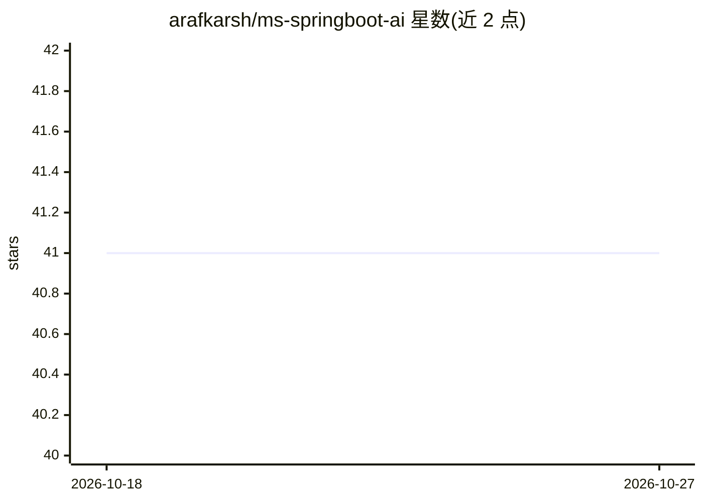

# arafkarsh/ms-springboot-ai

⭐ 41 · Java · Apache-2.0 · 推送 2026-07-18 · [GitHub](https://github.com/arafkarsh/ms-springboot-ai) · [官网](https://www.arafkarsh.com) · 个人维护

**Java 23 + SpringBoot 3.4.1 的生成式 AI 示例集（LangChain4J/DL4J）**

面向 Java 开发者的 AI/ML 与生成式 AI 示例工程：基于 LangChain4J 0.36.0 与 Deeplearning4j 1.0.0-M2.1，提供 12 类 Gen AI 示例与 9 类 RAG 示例，覆盖 8 种 LLM（GPT 4o、Claude 3、Gemini 1.5、Llama 3、Mistral、Phi-3、Gemma、Falcon 2）的横向特性对照表与评分。含医疗诊断微服务案例、租车服务 RAG 聊天机器人、情感分析、内容审核等。支持 H2/PostgreSQL 密码加密，本地 LLM 通过 Ollama 安装，云端 LLM 需自备 API key。运行需 JDK（Java 23）。

## 筛选速览

| 维度 | 判定 | 备注 |
|---|---|---|
| AI 角色 | `ai-knowledge` | 知识聚合/清单类 |
| 许可风险 | `permissive` | Apache-2.0 |
| 部署形态 | `None` |  |
| 模型依赖 | local-ok | 支持本地模型 |
| 硬件要求 | — | 无带数字的原话,不猜 |
| 安装摩擦 | `medium` | 含编译或系统依赖之一 |
| 成熟度 | — | 结构信号不足 |

## 能力要点

- 12 类 Gen AI 示例 + 9 类 RAG 示例，横跨 8 种云端/本地 LLM
- 基于 LangChain4J 的特性对照矩阵与 21 项企业特性评分排名
- 医疗诊断微服务与租车服务 RAG 聊天机器人案例
- H2/PostgreSQL 数据库密码加密方案（密钥存于环境变量）

## 适用场景

- Java 开发者学习如何在 SpringBoot 中接入各类 LLM
- 对比不同 LLM 在 Tools、Chat Memory、Data Extractor 等企业特性上的差异
- 参考 RAG（查询路由/重排/多检索器）与情感分析的实现代码

## 场景标签

`RAG` `教程课程` · 领域:知识与检索

## 证据(README 行号)

> L1: # AI/ML & Gen Ai - Langchain4J & Deep Learning 4J
> L77: ## Gen AI Examples: Comparison of 8 LLMs (3 Cloud based & 5 Local) on Enterprise Features
> L129: To Install the Local LLMs using Ollama

## 星数曲线

2026-10-18 41 → 2026-10-27 41（+0）

---
*卡片 v1 · prompt 1.4 · 生成 2026-10-25 · 置信度 high · 依据 README sha `c0f89c44e1f4` · [字段定义](../../DATASET.md)*
